# Release 1: functional foundation {#sec:ch3}

## Introduction {.unnumbered}

The first release lays the foundation every later feature depends on. Sprint 1
delivers the data model, authentication and the core of article management; Sprint 2
delivers the rich-text editor, the first version of the AI assistant and the capture
of reading events that the analytics of Release 2 will aggregate. Each sprint is
presented in the same four steps: its backlog, the analysis, the design and the
realisation.

## Sprint 1 — Schema, authentication and article core {#sec:sprint1}

### Sprint backlog

The goal of Sprint 1 is that a visitor can register and sign in, by password or with
Google; that a writer can create, edit, publish and delete articles, choosing their
placement and visibility; that a visitor can browse the public feed and read free
articles; and that the ledger invariant harness exists before any feature moves money.
@tbl:sprint-1 lists the stories committed.

<!-- INCLUDE:sprint-1 -->

The sprint commits {{S1PTS}} points, close to the average of the project. Almost a
fifth of them (US-49, US-50, US-51) produce nothing a user sees — the invariant harness,
the one-command stack and the quality gates — and were placed first on purpose: every
later sprint is built and verified with them.

### Analysis

**Use case diagram.** @fig:uc-s1 refines the global diagram for the scope of Sprint 1.

{#fig:uc-s1}

Registering specialises into registering as a reader or as a magazine; managing one's
own articles specialises into creating a draft, editing, publishing and deleting;
publishing includes choosing a placement and a visibility. The diagram shows that from
the first sprint every account is one of two types and every article has a placement:
the two properties on which the marketplace of Release 3 rests are in place before the
marketplace itself.

**Textual description.** @tbl:uc-publish details the central use case of the sprint.

| Item | Description |
|:----------------------|:----------------------------------------------------------|
| Use case | Publish an article |
| Actor | Writer (A4) |
| Pre-condition | The writer is signed in and owns a draft |
| Post-condition | The article is published with its placement, visibility, slug and reading time |
| Main scenario | 1. The writer opens the publish dialog. 2. The writer chooses a placement (public or marketplace) and, for a public article, a visibility (free or premium), and sets the cover, tags and excerpt. 3. The system checks the choices. 4. The system publishes the article and computes its word count and reading time. 5. The article appears in the feed (public) or is kept for the marketplace (marketplace). |
| Alternative scenario | 3a. A marketplace placement without a price: the system refuses and keeps the draft. |

: Textual description of "Publish an article" {#tbl:uc-publish}

The description shows the scope of Sprint 1 for publishing: the placement and the
visibility are stored and validated, but nobody yet acts on them. From Sprint 5, the
premium visibility and the marketplace placement are reserved to eligible writers
(FR-35, FR-36), which adds a refusal at step 3; FR-23 and FR-24 are therefore
delivered in two steps, and the backlog records both sprints.

### Design

**Class diagram.** @fig:classes-s1 shows the classes of Sprint 1.

{#fig:classes-s1}

The `User` carries its account type, authentication provider, role and plan; the
`MagazineProfile` extends a magazine account with its name, slug and branding; the
`Article` carries its status, placement, visibility and generated search vector; tags
are a many-to-many association and comments form a thread. The diagram shows the
single-table design of accounts: one `User` class for every kind of account, the
differences carried by attributes, and a database constraint that keeps role and plan
empty for a magazine. That is what lets one authentication path serve every actor.

**Sequence diagram — sign in.** @fig:seq-auth shows signing in and the silent refresh
that keeps a session alive.

{#fig:seq-auth}

Sign-in is rate-limited per address — ten attempts a minute, five for registration,
against sixty for other routes — and answers 429 before the account is even read. On
success the system issues a 15-minute access token and a 7-day refresh token; when a
later request meets an expired access token, the client refreshes it, rewrites both
the client store and the cookie the route proxy reads, and retries the original
request transparently. The diagram shows why a long writing session is never
interrupted (US-04) while a stolen or revoked access token is useful for at most
fifteen minutes (NFR-02, NFR-09).

**The ledger invariant harness.** Money-like data appears from Sprint 5 onwards, but
its correctness rule is set here: every denormalised balance — a magazine's credit
balance, a writer's earnings — must equal the sum of its ledger rows. Three invariants
encode that rule and are asserted after every test that moves credits. The harness is
itself tested by sabotage: fixtures build a coherent purchase, then corrupt one column
at a time and check that the right invariant fails. Writing the check before the
feature means that no purchase code was ever written without it.

### Realisation

The realisation of Sprint 1 is what a visitor sees first. @fig:home shows the public
feed reached without an account.

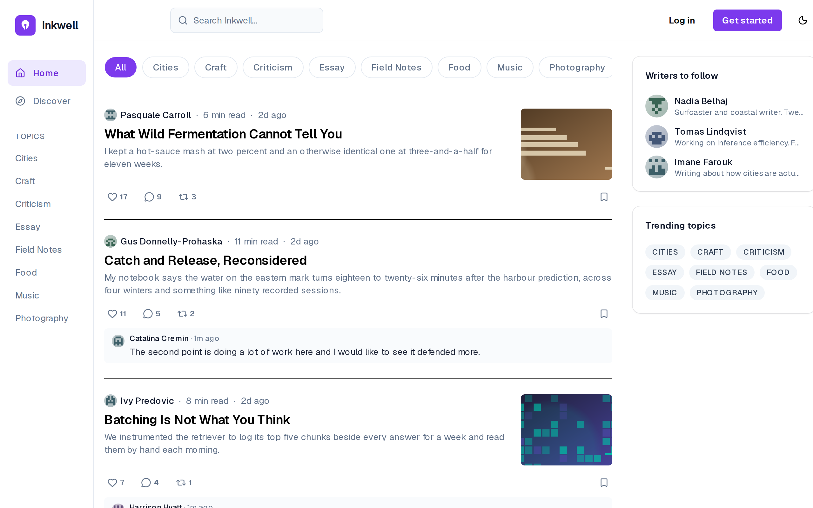{#fig:home}

The feed lists published public articles with their author, reading time, excerpt,
cover and reaction counts, filtered by topic along the top (FR-01). The header offers
only *Log in* and *Get started*: a visitor can read and browse but every interaction
leads to an account, which is the boundary between actor A1 and the others.

@fig:login shows the sign-in page.

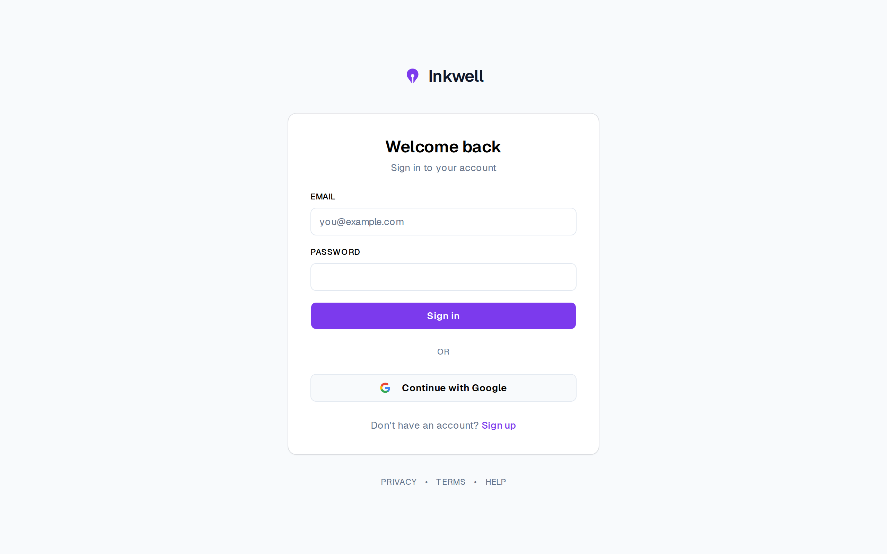{#fig:login}

It offers the two authentication methods of FR-05 side by side — e-mail and password,
and *Continue with Google* — and the link to registration that @fig:uc-global draws as
*Create an account* extending *Sign in*.

Registration differs by account type. @fig:register shows a personal account and
@fig:register-magazine a magazine account.

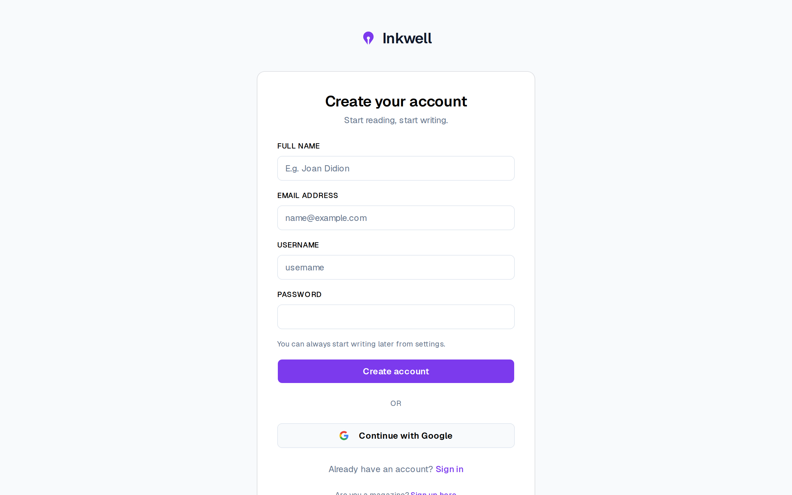{#fig:register}

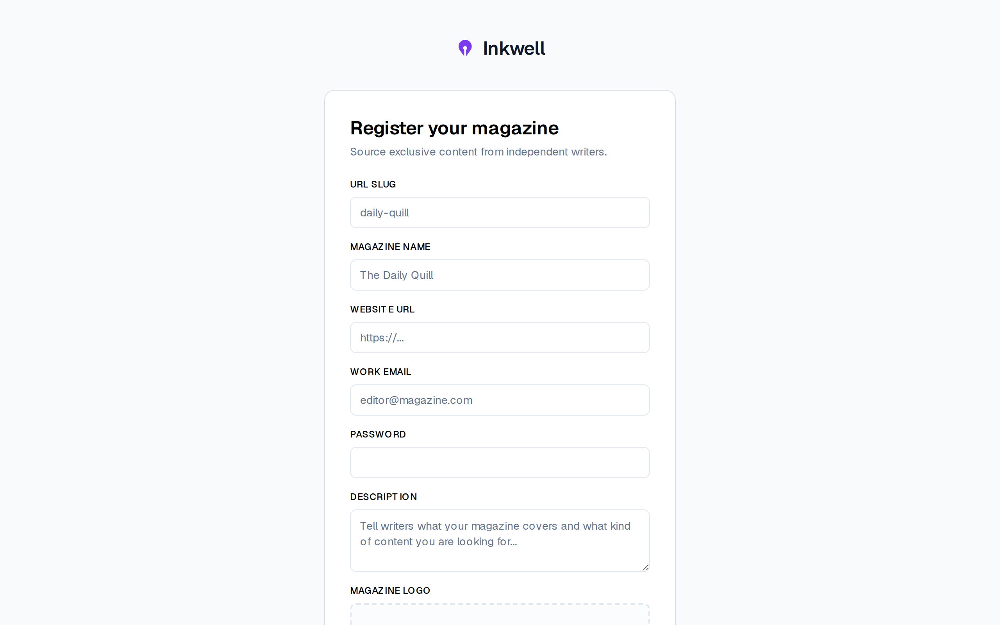{#fig:register-magazine}

The magazine form asks for what a writer will see of the buyer — the slug that becomes
the magazine's public address, its name, website, description and logo — and none of
the personal fields. The two forms are FR-04 and FR-39: one platform, two kinds of
account from the first screen, which is why a magazine never inherits a reader's
capabilities.

@fig:article-free shows a free article opened by a visitor.

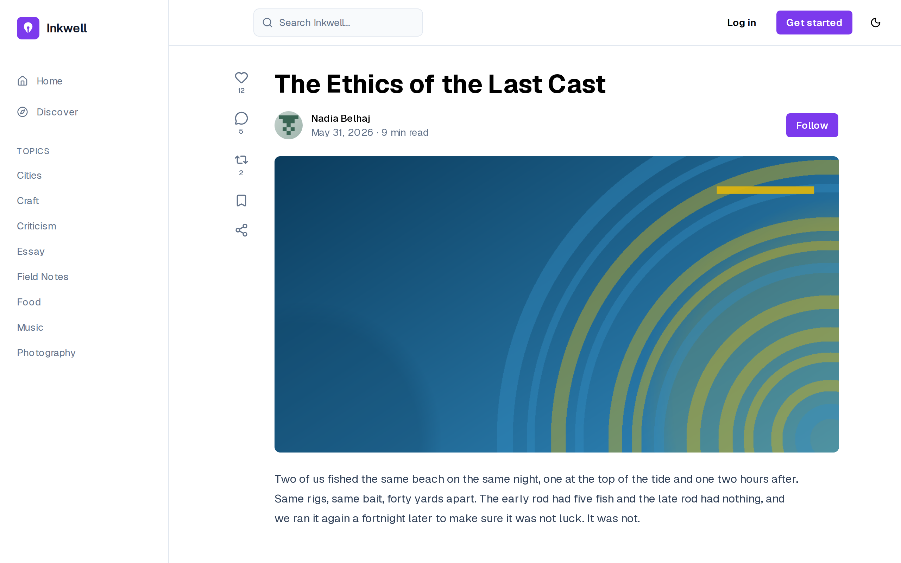{#fig:article-free}

The full body is readable without an account (FR-02). This was a deliberate decision:
gating free articles would contradict the public feed and hide the content from search
engines, so the only articles a visitor cannot read are premium and marketplace ones,
for which Release 3 adds the paywall.

@fig:settings closes the sprint with the profile settings.

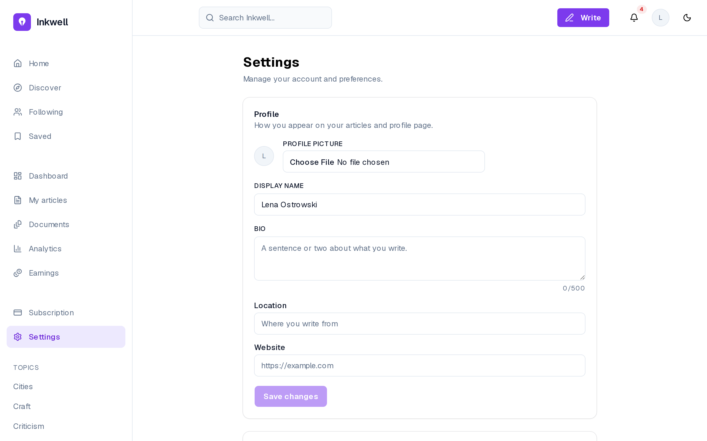{#fig:settings}

A signed-in user edits the display name, bio, location, website and profile picture
(FR-07); the picture is uploaded straight to object storage through a presigned URL
(NFR-07). *Save changes* stays disabled until something changes, so a click never sends
an empty update.

## Sprint 2 — Editor, AI assistance and event capture {#sec:sprint2}

### Sprint backlog

The goal of Sprint 2 is that a writer drafts in a rich-text editor with automatic
saving and images; that a premium writer converses with an AI assistant and applies
inline AI actions to a selection, within a daily token allowance; and that every
article page records reading events. @tbl:sprint-2 lists the stories.

<!-- INCLUDE:sprint-2 -->

The sprint commits {{S2PTS}} points, and its single largest story, US-14 (13 points),
is split across two sprints: Sprint 2 delivers the conversation with the assistant,
Sprint 4 the retrieval that grounds it in the writer's corpus. The editor stories
(US-06 to US-09) come straight from the screens of the design track, which is why
they could be estimated with confidence.

### Analysis

@fig:uc-s2 gives the use cases of Sprint 2.

{#fig:uc-s2}

Writing in the editor specialises into formatting, inserting an image and setting a
cover image, and includes saving the draft automatically. Using the assistant
specialises into chatting and applying an inline action, and includes consuming the
daily allowance; inserting the answer into the document extends the chat. Reading an
article includes recording reading events. The diagram shows that every AI use case
passes through the allowance: there is no path to a model that is not counted.
The allowance belongs to the premium plan (FR-17); in this sprint premium accounts
are created by the seed, and upgrading from the interface arrives with the plans of
Sprint 5.

### Design

**Class diagram.** @fig:classes-s2 adds the classes of Sprint 2.

{#fig:classes-s2}

Each AI call is logged as an `AiInteraction` with its action type, tokens used and
model; reading is recorded as `AnalyticsEvent` rows (view, scroll, time on page, like,
comment, repost); and the user carries the remaining daily token allowance and the time
of its last reset. The diagram shows that cost and reading are both recorded as
append-only rows: the allowance can be audited from the interaction log, and every
metric of Release 2 is computed from events written from this sprint on.

**Sequence diagram — inline AI action.** @fig:seq-inline shows an inline action on a
selection.

{#fig:seq-inline}

The editor captures the selected range once, before anything is streamed, so that a
click elsewhere cannot move it. The system checks the daily allowance and refuses with
403 and a plan-aware notice when it is exhausted; otherwise it builds the prompt from
the action, the selection and the surrounding article, streams the suggestion to the
editor as it is generated, and records the interaction and its cost. The allowance is
checked once, before the call: a reply may cost more than what remained, and the
balance then stops at zero. The diagram shows the trade-off chosen — the writer is
never cut off in the middle of a reply, at the price of a small overrun on the last
call of the day.

**Event capture.** The article page observes scroll depth and engaged time and sends
batched events — every ten events, every five seconds, or when the page is left — to
`POST /analytics/events`. The server, not the client, attaches the reader's identity
from the access token, the country and the device, so a reader cannot forge another
reader's events. Capture starts in this sprint so that real reading data accumulates
before the dashboards of Release 2 aggregate it.

### Realisation

@fig:editor shows the editor, where a writer spends most of their time.

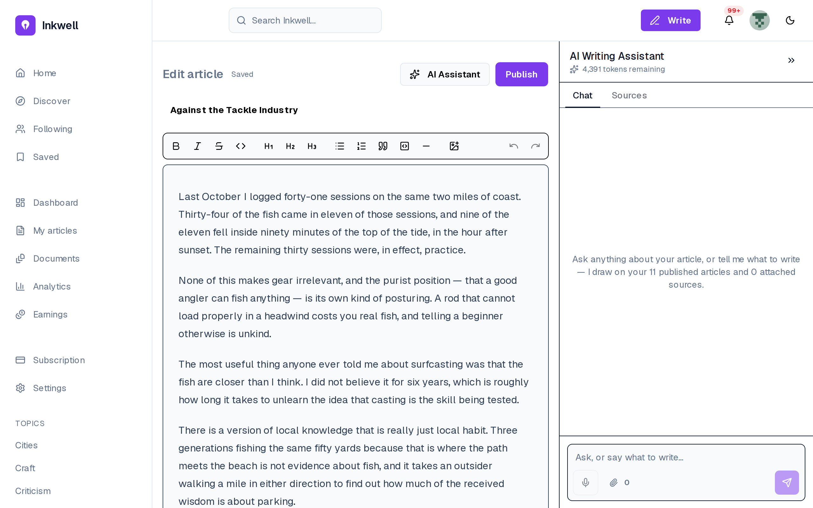{#fig:editor}

The draft is edited as rich text, with a toolbar for emphasis, three heading levels,
lists, quotes, code and images (FR-18, FR-20); the *Saved* label beside the title
reports the automatic save that replaces a save button (FR-19). The assistant sits beside the text rather than in another page,
which is the premise of the whole product: help arrives where the writing happens.

@fig:publish-dialog shows the publish dialog designed in Sprint 1 and used here.

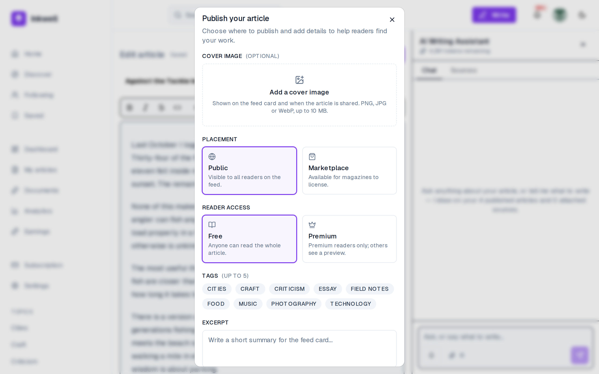{#fig:publish-dialog}

Every choice of @tbl:uc-publish is on one screen — placement, visibility, cover, tags
and excerpt (FR-21, FR-23, FR-24) — so publishing is a single confirmed act and not a
sequence of settings pages.

The assistant is shown in two states. @fig:ai-panel shows the panel before a question
and @fig:ai-answer an answer.

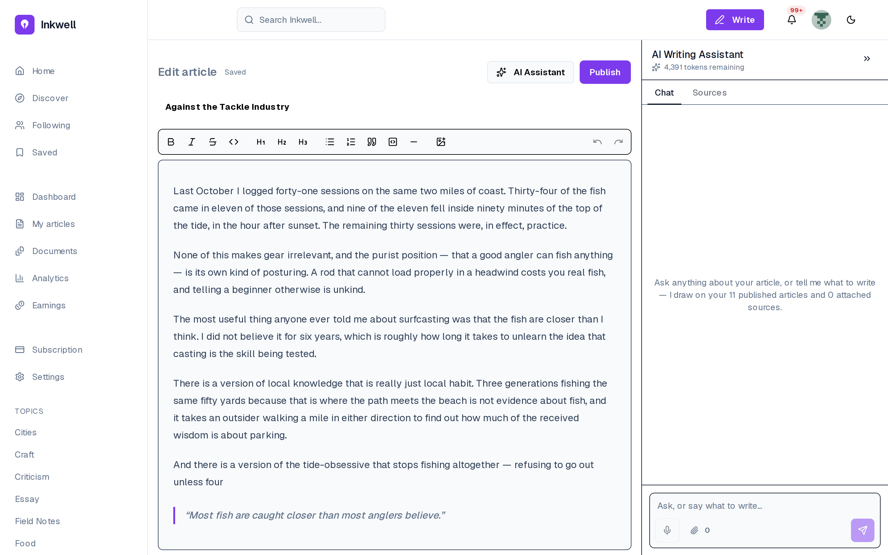{#fig:ai-panel}

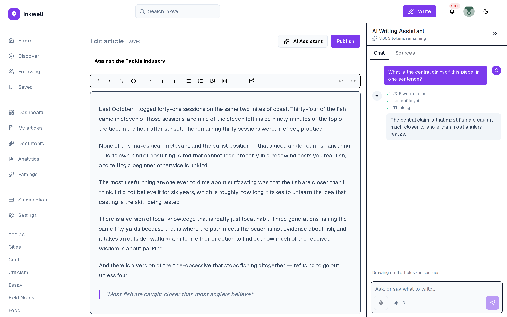{#fig:ai-answer}

The panel shows the remaining allowance — 20,000 tokens at the start of the day —
before the writer asks anything (FR-31), so the cost of a question is never a
surprise. The answer is streamed as it is generated
and can be inserted into the document at the cursor (FR-27, FR-30); Sprint 8 later
replaces this manual insertion by an assistant that writes into the document itself.

The inline actions are the second way to use the assistant. @fig:inline-menu shows the
menu on a selection and @fig:inline-suggestion its result.

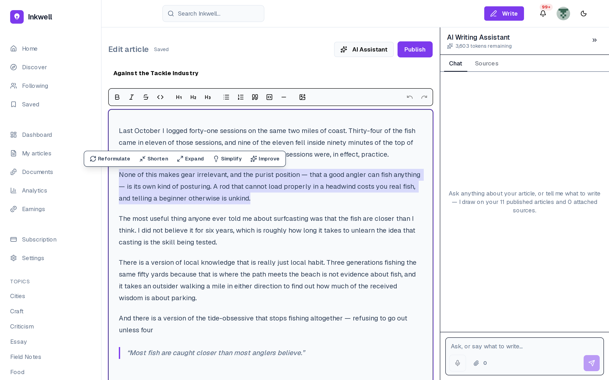{#fig:inline-menu}

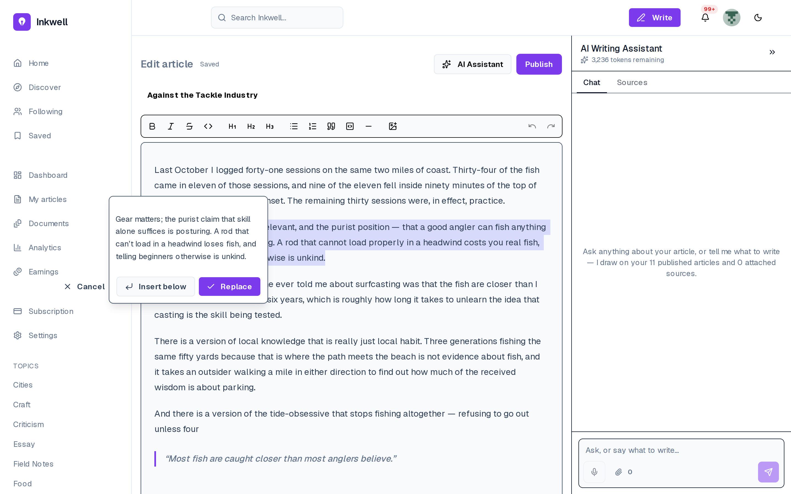{#fig:inline-suggestion}

Selecting text opens the five actions of FR-28 — reformulate, shorten, expand,
simplify, improve. The suggestion appears in a popover over the highlighted original
rather than replacing it, with three choices: *Replace*, *Insert below* or *Cancel*.
The allowance in the panel has dropped accordingly. The assistant proposes and the
writer decides, which is the rule the whole assistant follows.

## Conclusion {.unnumbered}

Release 1 delivered the foundation: accounts of two types with rate-limited
authentication and a silent refresh, article management with placement and
visibility, a rich-text editor, the first AI assistant with inline actions under a
daily allowance, the capture of reading events, and the ledger harness that every
later money-moving feature is tested against. Release 2 builds the social layer and
the analytics on top of it.
