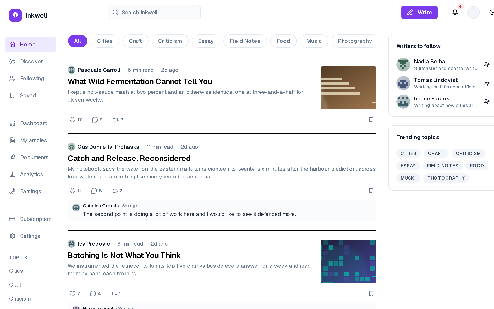
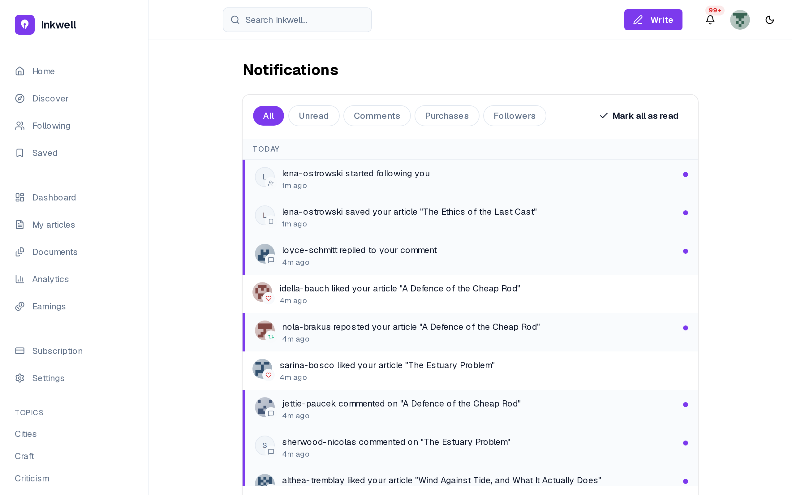
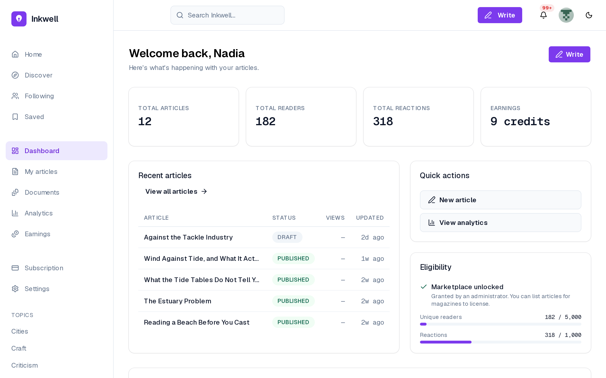
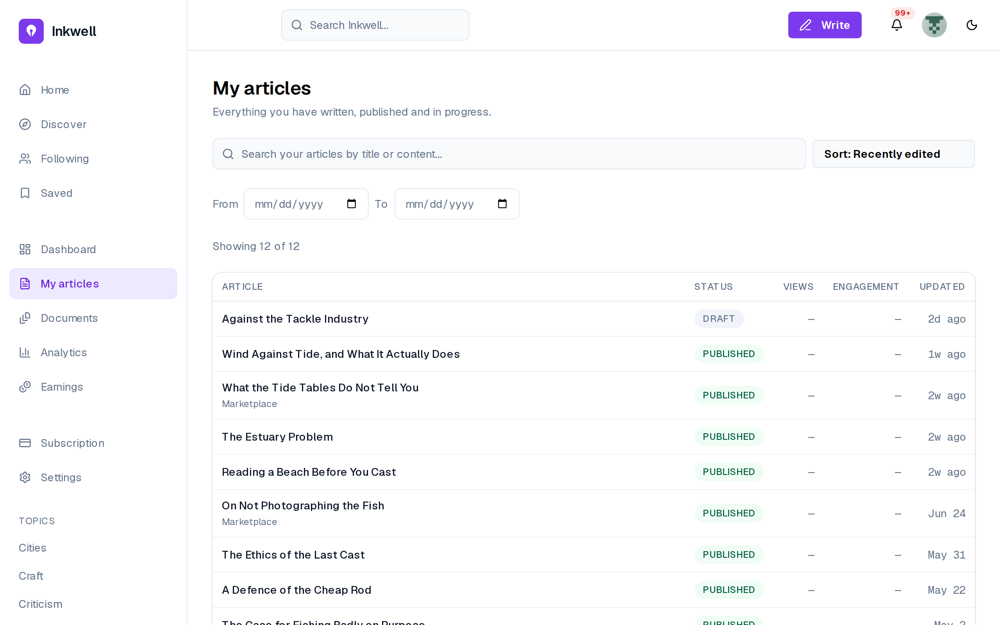
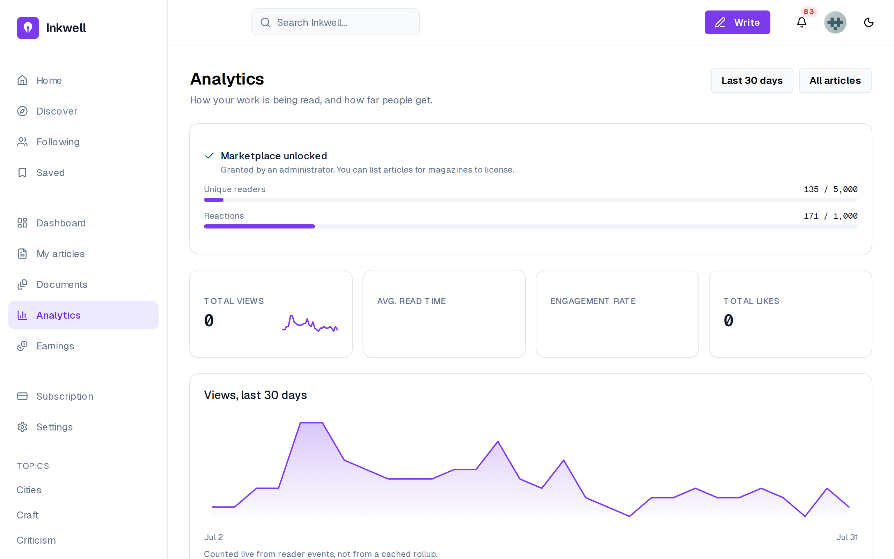
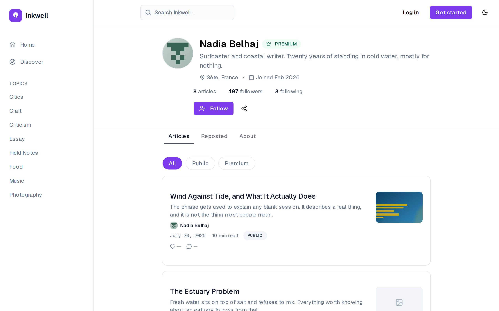
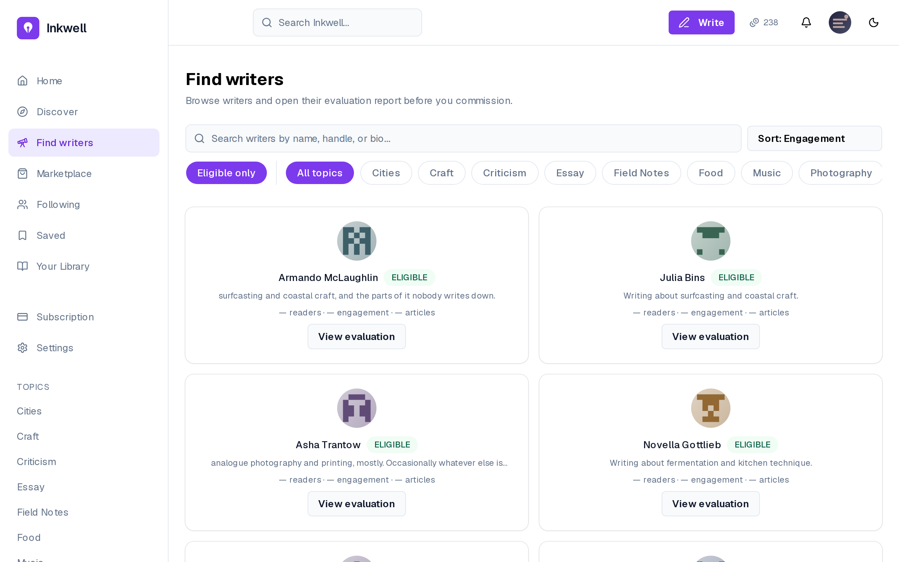
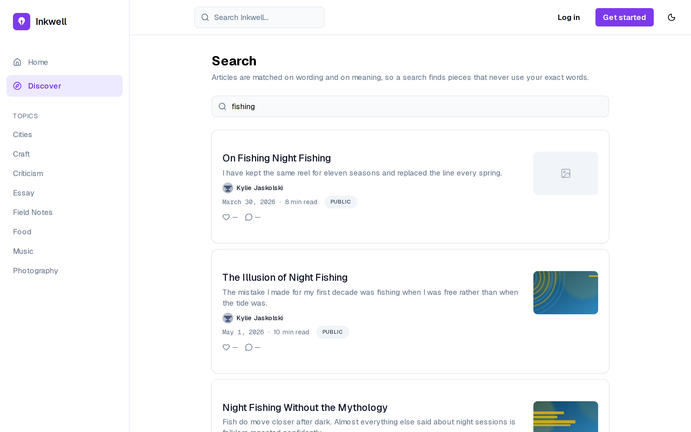
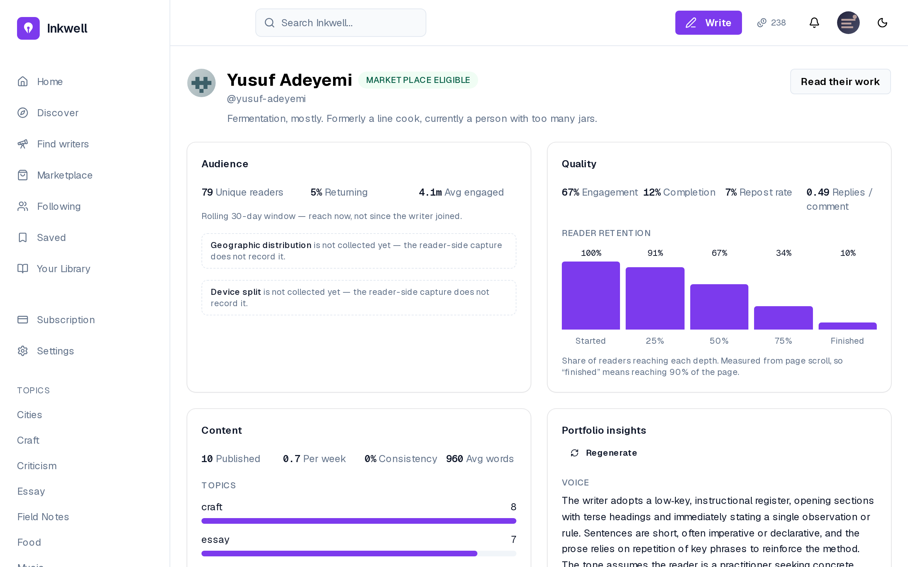

# Release 2: social interactions, analytics and AI {#sec:ch4}

## Introduction {.unnumbered}

The second release turns a publishing tool into a platform. Sprint 3 adds the social
layer — likes, threaded comments, reposts, follows, reports — with live notifications,
and aggregates the reading events captured since Release 1 into the metrics behind the
writer's dashboards and the magazine's evaluation report. Sprint 4 adds the platform's
retrieval layer: published articles are embedded, the assistant answers from the
writer's own passages and voice profile, magazines can request AI portfolio insights,
and search combines keywords with meaning.

## Sprint 3 — Social interactions, notifications and analytics {#sec:sprint3}

### Sprint backlog

The goal of Sprint 3 is that readers interact with articles and writers and the author
is told live; that writers see how their articles are read; and that magazines browse
writers and read an evaluation report built on audience, content and quality metrics.
@tbl:sprint-3 lists the stories.

<!-- INCLUDE:sprint-3 -->

The sprint commits {{S3PTS}} points. Its weight is concentrated in two analytics
stories, the writer's per-article analytics (US-30, 8 points) and the evaluation report
(US-32, 13 points): the social stories are small and similar to one another, while the
evaluation needs the aggregation pipeline that every metric depends on.

### Analysis

@fig:uc-s3 gives the use cases of Sprint 3.

{#fig:uc-s3}

Interacting with an article specialises into liking, commenting, replying, reposting,
following and reporting, and includes notifying the recipient. On a marketplace
listing, liking, commenting and reposting are refused while saving stays available,
because a listing is a private commercial offer rather than a publication (FR-70).
Viewing article analytics and reading a writer evaluation both include the aggregation
of raw events into metrics — a scheduled job rather than a user action, drawn because
no metric exists without it. The diagram therefore shows the two halves of the sprint
joined at one point: interactions produce events, and the aggregation turns events
into the numbers both the writer and the magazine read.

### Design

**Class diagram.** @fig:classes-s3 adds the classes of Sprint 3.

{#fig:classes-s3}

Likes, reposts and follows are many-to-many associations; comments and notifications
are classes because they carry content and state. The four rollup tables are
`ArticleMetrics` per article, and `WriterAudienceMetrics`, `WriterContentMetrics` and
`WriterQualityMetrics` per writer. The diagram shows that the metrics are stored
separately from the events they summarise: each rollup has one row per article or per
writer, rewritten by the aggregation, so reading a dashboard costs the same whatever
the number of events behind it.

**Sequence diagram — from reading events to metrics.** @fig:seq-aggregation follows a
reading event to the dashboard.

{#fig:seq-aggregation}

The browser batches events; the API takes the reader's identity from the access token
when one is sent — never from the request body — and attaches the time and device
server-side before appending the event. Every five minutes the worker reads only the
events since the last run and upserts the per-article metrics; just after, it computes
the three per-writer rollups and rechecks marketplace eligibility. Dashboards read the
rollups, never the raw events, so they stay fast as the event log grows (NFR-15,
NFR-16). The diagram shows the one place where freshness is traded for speed: a metric
can be up to five minutes behind the events.

The metrics the aggregation produces are those of the evaluation report, defined in
@tbl:metrics. Each definition is the one the aggregation computes.

| Panel | Metric | Definition | Why this definition |
|:--------|:--------------------|:-------------------------------------|:--------------------------------|
| Audience | Unique readers | distinct identified readers over the last 30 days | reach now, not since the writer joined |
| Audience | Returning-reader rate | share of those readers seen on more than one day | a reader who refreshes twice is not loyal; one who comes back another day is |
| Content | Posting frequency | articles per week | regularity is what a magazine commissioning a series needs |
| Content | Consistency | 1 − coefficient of variation of the gaps between articles, clamped to [0, 1] | 1 is perfectly regular; near 0 is bursts and silences |
| Content | Topics | distribution of the writer's articles over tags | the range a magazine can draw on |
| Quality | Engagement rate | (likes + comments) per view | interaction per reader; it exceeds 100% when articles collect more reactions than views |
| Quality | Completion rate | share of views that scroll to 90% of the article | 90% rather than 100%, because footers and comments sit below the text |
| Quality | Repost rate, comment depth | reposts per view; replies per top-level comment | whether readers pass the work on and discuss it |
| Quality | Retention curve | share of views reaching 25%, 50%, 75% and 90% of the page | where readers stop, at the granularity page scroll supports |

: Main metrics of the evaluation report {#tbl:metrics}

The table shows that every metric is a ratio or a distribution rather than a raw
count, so that a writer with a small but attentive audience can compare with a writer
with a large and indifferent one. It also shows the limit of the capture: the retention
curve has four points because the browser records the deepest scroll, not the
paragraph being read.

**Sequence diagram — live notifications.** @fig:seq-notify shows how a notification
reaches its recipient.

{#fig:seq-notify}

The client keeps a server-sent-events stream open; when a reader likes an article, the
like and the notification row are written first, and only after the commit is the
event pushed to the recipient's open streams. If the connection drops, the client
reconnects with the identifier of the last event received and the server replays what
was missed. The diagram shows why a notification is never lost and never announces
something that did not happen: the database is the record, and the live push is only a
faster way to read it.

### Realisation

@fig:feed-reader shows the feed of a signed-in reader.

{#fig:feed-reader}

Compared with the visitor's feed of @fig:home, the header now offers *Write*, the
notification bell and the account; each card carries like, comment, repost and save
controls with their counts, and the side panel suggests writers to follow (FR-08,
FR-09, FR-11, FR-12). The latest comment under a card is the live preview added in
Sprint 8.

@fig:notifications shows the notifications of a writer.

{#fig:notifications}

Notifications are grouped by day, filtered by kind — unread, comments, purchases,
followers — and unread ones are marked by a bar and a dot until *Mark all as read*
(FR-13, FR-14). The list mixes social events with marketplace ones, so a writer follows
both the conversation around their work and its sales in one place.

The writer's view of their own work is shown in three screens. @fig:dashboard is the
dashboard, @fig:my-articles the list of articles and @fig:writer-analytics the
analytics.

{#fig:dashboard}

The dashboard summarises articles, readers, reactions and earnings, lists the recent
articles with their status and views, and shows the eligibility panel: 182 of 5,000
readers and 318 of 1,000 reactions, with the marketplace already unlocked by an
administrator's grant (FR-34, FR-55). It answers the writer's first question — how am I
doing — on one screen.

{#fig:my-articles}

"My articles" lists every article, drafts and marketplace listings included, searchable
by content and filterable by date, with its views and engagement (FR-33). The
engagement column is the per-view rate of @tbl:metrics, which is why values above 100%
appear on articles whose seeded reactions outnumber their recorded views. Sorting
happens on the server across the whole body of work, not on the page shown.

{#fig:writer-analytics}

The analytics page gives the totals — views, average read time, engagement rate,
likes — and the daily views of the last 30 days (FR-32). The note under the chart says
that it is counted from the events, not from a rollup: a daily series is the one panel
that may read the event log directly, bounded to thirty days, as NFR-15 allows.

@fig:writer-profile shows a writer's public profile.

{#fig:writer-profile}

The profile shows the writer's bio, location, join date, article and follower counts
and published articles to any visitor, filterable by public and premium, with a
*Follow* control and a share button (FR-12). It is the public face of the portfolio
that a magazine evaluates in more depth.

@fig:find-writers shows the magazine's side of the same data.

{#fig:find-writers}

A magazine browses writers filtered to the eligible ones and by topic, searches them by
name or bio, and sorts them — here by engagement (FR-44). Each card already gives
readers, engagement and article count, and *View evaluation* opens the full report. In
this sprint the page is reachable by any magazine account; from Sprint 5 it sits behind
the subscription wall, which is why FR-44 is attributed to both sprints.

## Sprint 4 — Retrieval, portfolio insights and hybrid search {#sec:sprint4}

### Sprint backlog

The goal of Sprint 4 is that published articles become a retrievable corpus; that the
assistant answers from the writer's own passages and shows them; that each writer gets
an automatically extracted voice profile; that magazines request AI portfolio
insights; and that search finds articles by meaning as well as by keyword.
@tbl:sprint-4 lists the stories.

<!-- INCLUDE:sprint-4 -->

The sprint commits {{S4PTS}} points, the second heaviest load of the project. Its
stories share one new component — the embedding of published articles — and could only
be estimated once it existed, which is why the sprint begins with it.

### Analysis

@fig:uc-s4 gives the use cases of Sprint 4.

{#fig:uc-s4}

Searching specialises into searching by keyword and by meaning and includes merging the
two result sets; using the assistant includes retrieving passages from the writer's own
corpus and showing the sources used; publishing includes embedding the article,
extracting the writer's voice profile and invalidating the insights cache; reading a
writer evaluation is extended by generating portfolio insights. The diagram shows that
publishing has become the trigger of the whole AI layer: every capability of the sprint
depends on what happens after a writer clicks *Publish*.

### Design

**Class diagram.** @fig:classes-s4 adds the retrieval corpus.

{#fig:classes-s4}

An `ArticleChunk` is a passage of a published article with its 1,536-dimension
embedding; the `WriterMemory` holds the extracted voice profile (tone, style examples,
vocabulary, topics); the `PortfolioInsight` caches the AI assessment of a writer; the
`AiInteraction` log records every call. The diagram shows that the AI layer adds data
derived from articles and never modifies them: every chunk, profile and insight can be
deleted and rebuilt from the published articles, which is what the re-embedding on
every publication does.

**Sequence diagram — what publishing sets in motion.** @fig:seq-publish shows the
background pipeline a publication starts.

{#fig:seq-publish}

The API writes the article and enqueues an embedding job. The worker deletes the
article's previous chunks, splits it into passages of 120 to 1,200 characters — each
prefixed with its nearest heading, so that a short paragraph embeds near its
subject — embeds them, stores the vectors and drops the writer's cached insights. It
then chains the extraction of the voice profile from the most recent articles, which
the model returns as a schema‑validated object. The diagram shows that publishing
returns immediately: the writer never waits for an embedding, and a failure of the
provider delays retrieval without blocking publication.

**Sequence diagram — a chat turn grounded in the writer's corpus.** @fig:seq-rag shows
retrieval-augmented generation, the technique of conditioning a language model on
passages retrieved for the question [@lewis2020rag; @gao2023ragsurvey], as delivered
in this sprint.

{#fig:seq-rag}

The question is embedded; the five passages of the writer's own work closest to it by
cosine similarity are retrieved, provided they score above 0.60; the voice profile is
read; the prompt is assembled from role, memory, passages and question; the answer is
streamed, and the passages used are shown as sources. The similarity floor lets
retrieval return *nothing* rather than five irrelevant passages, and the voice profile
keeps the answer in the writer's style even then. @sec:eval-rag measures how well
this retrieval finds the right passage and how often the floor correctly returns
nothing.

**Sequence diagram — hybrid search.** @fig:seq-search shows search.

{#fig:seq-search}

The query is ranked lexically with `ts_rank` over the article's weighted search vector
[@postgres16fts], and semantically by cosine similarity, keeping the best passage per
article. Because the two scores are on unrelated scales, the rankings are fused by
position with reciprocal rank fusion — each article scores Σ 1/(60 + rank) over the two
lists [@cormack2009rrf] — so an article that never uses the searcher's words can still
be found by meaning. The diagram shows that the two rankings are independent and run in
parallel: if the embedding provider fails, search degrades to keyword search instead
of failing. @sec:eval-search compares the three rankings on the same queries.

### Realisation

@fig:search shows search results for a visitor.

{#fig:search}

The page says how it works — articles are matched on wording and on meaning (FR-06).
For "fishing", the first results are articles whose titles contain the word: they rank
high in both the lexical and the semantic list, and reciprocal rank fusion rewards
agreement between the two. Search is available without an account, like the feed.

@fig:evaluation shows the evaluation report that a magazine reads before buying.

{#fig:evaluation}

The report gives the three panels of @tbl:metrics — audience, quality with its
retention curve, and content with its topics — and the portfolio insights generated by
the model, here a description of the writer's voice, with *Regenerate* as the explicit
action of FR-46 (FR-45, FR-46). Two fields the capture cannot measure, geographic
distribution and device split, are stated as not collected rather than shown as zero.
The screen is the reason the analytics exist: it turns reading into evidence a buyer
can weigh.

## Conclusion {.unnumbered}

Release 2 made Inkwell.ai social and measurable: interactions with live notifications,
reading events aggregated into per-article and per-writer metrics, an evaluation report
for magazines, and a retrieval layer that grounds the assistant in the writer's own
work, produces portfolio insights and powers hybrid search. Release 3 builds the
marketplace those signals were designed for.
