# Release 3: marketplace, testing and deployment {#sec:ch5}

## Introduction {.unnumbered}

The third release delivers the reason the analytics exist: the marketplace. Sprint 5
adds the premium plan, magazine subscriptions and credits, the eligibility gate, the
two-stage purchase with exclusive rights, the magazine's own act of publishing, and the
moderation console. Sprint 6 is a technical sprint: it delivers no new screen, but the
test strategy that proves the business rules of Sprint 5, a demonstration corpus, and a
deployable production stack. Both sprints follow the same four steps as the others.

## Sprint 5: Marketplace, subscriptions, premium and moderation {#sec:sprint5}

### Sprint backlog

The goal of Sprint 5 is that readers upgrade to premium; that magazines subscribe and
receive monthly credits; that eligible writers list articles; that magazines preview,
buy and publish them under their own masthead, every credit movement recorded in a
ledger; that writers see their earnings; and that administrators moderate.
@tbl:sprint-5 lists the stories.

<!-- INCLUDE:sprint-5 -->

The sprint commits {{S5PTS}} points, about twice the average of the other sprints. The
load was accepted rather than split because the marketplace stories form one
transaction model: a preview, a purchase, a publication and an earnings line are four
views of the same ledger rows, and delivering half of them would have left money that
could be spent but not accounted for. The ledger harness of Sprint 1 and the screens of
the design track had removed most of the uncertainty in advance. How far this
estimate held is discussed with the velocity in @sec:velocity.

### Analysis

**Use case diagram.** @fig:uc-s5 gives the use cases of Sprint 5.

{#fig:uc-s5}

Without an active subscription a magazine can only subscribe; with one, it browses,
previews and buys articles exclusively, tops up credits and publishes from its
library, every credit movement in one transaction. A writer lists an article when
`[writer is eligible]`; the administrator moderates and grants eligibility. The
subscription is the wall in front of the marketplace.

**Business rules.** The marketplace is governed by the rules of @tbl:rules. They are
part of the analysis because every screen and every test of the sprint applies them.

| Rule | Value | Justification |
|:----------------------|:--------------------------------|:--------------------------------|
| Eligibility to list or publish premium | 5,000 identified unique readers **and** 1,000 reactions (likes and comments) across the writer's public articles, lifetime; or a manual grant by an administrator; never revoked automatically | both an audience and a response to it, so neither a viral article nor a small circle of friends qualifies alone; never revoked, so a writer's listings do not disappear in a quiet month |
| Magazine subscription | monthly; 500 credits a month; unspent credits roll over | a predictable budget (US-36); roll-over, so a magazine is not pushed to spend |
| Preview unlock | 10% of the article's price, credited towards the purchase | cheap enough to read before deciding, and never lost if the magazine buys |
| Full purchase | the remaining 90%; exclusive | exclusivity is what a publication pays for; the preview is deducted so the total is the price |
| Platform fee | 20% of each stage, rounded down; the writer receives the rest | rounded down so that the writer, not the platform, keeps the indivisible credit |
| Publication | a separate act of the owning magazine: the article becomes public and free, its price is cleared and the magazine is recorded as publisher | buying is not publishing; the magazine decides when its masthead appears (US-63) |

: Marketplace rules and their justification {#tbl:rules}

The rules have one property in common: each is an integer computation with a single
rounding, so the sum of what the writer, the platform and the magazine see always
reconciles to the credit. The values themselves (10%, 20%, 500, 5,000 and 1,000) are
product decisions, kept as named constants (@sec:parameters).

### Design

**Class diagram.** @fig:classes-s5 shows licensing and the ledger.

{#fig:classes-s5}

A `Purchase` records a stage (preview or full purchase) with the credits paid, the
fee and the payout, and writes three `Transaction` rows: the magazine's debit, the
writer's payout and the platform fee. No balance is stored without its explanation:
credit balances and earnings are caches of these rows, which the ledger invariants
check (NFR-19).

**Sequence diagram: the purchase.** @fig:seq-purchase shows the three calls of a
licence.

{#fig:seq-purchase .foldout .sideways height=88%}

Each stage is one transaction: it locks the article (409 if already owned) and the
credit balance (402 if too low), moves the credits and writes the ledger rows. The
row lock rules out a double purchase or double spend (NFR-20); the idempotency key, a
retried request charging twice (NFR-06).

**Activity diagram: the eligibility gate.** @fig:act-eligibility shows how a writer
becomes eligible.

{#fig:act-eligibility}

After each aggregation the worker marks the writers above both thresholds eligible
and logs the metric snapshot; an administrator can also grant eligibility, with the
same audit entry. Comment likes and reposts do not count, so other people's activity
cannot move a threshold. Every eligible writer can be traced to the numbers or the
person that made them eligible.

**Sequence diagram: moderation.** @fig:seq-moderation shows the two sources of
reports.

{#fig:seq-moderation}

After publication a classifier reviews the article and, if it flags it, files a
pending report without blocking publication; readers report articles, users or
comments. The administrator dismisses, removes the article or bans the author (in
effect within fifteen minutes, NFR-09). A false positive costs a dismissed report,
never a refused article; @sec:eval-moderation measures the classifier.

**Activity diagram: the article access decision.** @fig:act-access shows the decision
taken server-side for every article body.

{#fig:act-access}

The author and administrators always read. A marketplace body reaches only a
subscribed magazine that previewed or bought it, a premium body only the premium plan
or a subscribed magazine; otherwise the content is `null`. The server decides, so a
modified client cannot read what it has not paid for.

**State diagram: the article lifecycle.** @fig:state-article shows the states an
article goes through.

{#fig:state-article}

A draft is published as free, premium or listed. A listing can become public (never
the reverse) or be deleted while unsold; a purchase makes it *owned*, and the
magazine's publication public. No transition can destroy what a magazine paid for,
which enforces the exclusivity of @tbl:rules.

### Realisation

The premium plan comes first, because it is what a reader meets. @fig:paywall shows a
premium article opened by a visitor.

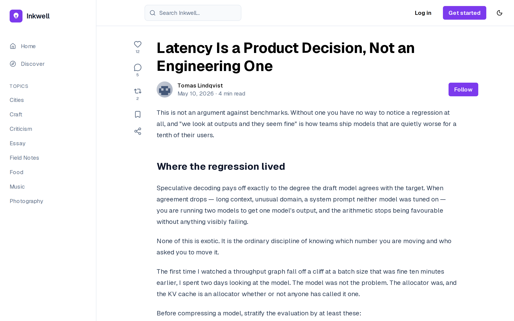{#fig:paywall}

The visitor sees the title, the author and the opening; the body is withheld by the
access decision of @fig:act-access (FR-03, FR-16). It never reaches the browser, so
inspecting the page cannot reveal it.

@fig:plans shows the plans offered to a reader.

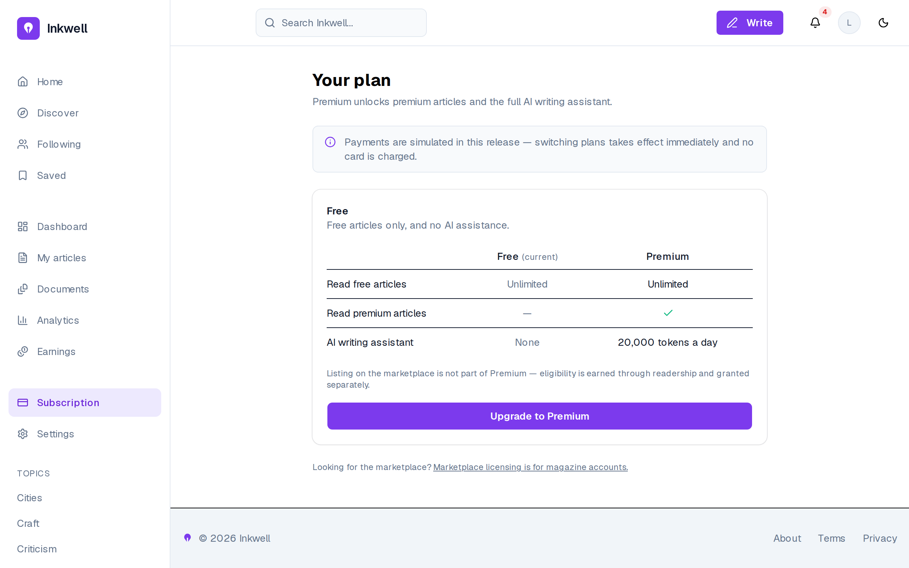{#fig:plans}

The comparison states the difference between the plans (premium articles and the AI
assistant with 20,000 tokens a day), and the banner states that payments are simulated
in this release (FR-15). The page also says that listing on the marketplace is not part
of premium: eligibility is earned, not bought, which is the rule of @tbl:rules.

The magazine's side starts with its subscription. @fig:subscription shows a subscribed
magazine.

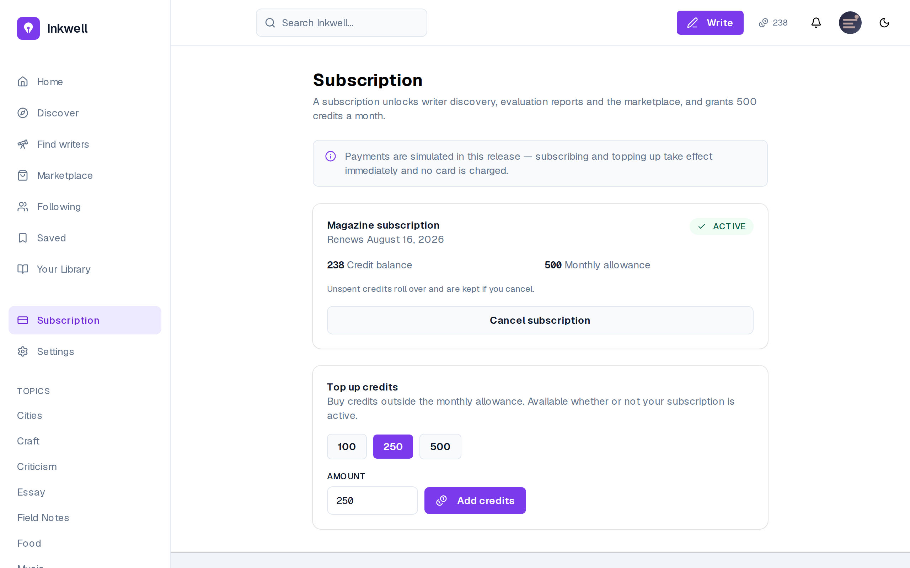{#fig:subscription}

The page shows the active subscription and its renewal date, the credit balance (238)
and the monthly allowance (500), and offers a top-up of 100, 250 or 500 credits
(FR-41, FR-42, FR-43). The note that unspent credits roll over and are kept on
cancellation is the subscription rule of @tbl:rules, stated where the magazine
decides.

@fig:marketplace shows the marketplace and @fig:listing a listing before preview.

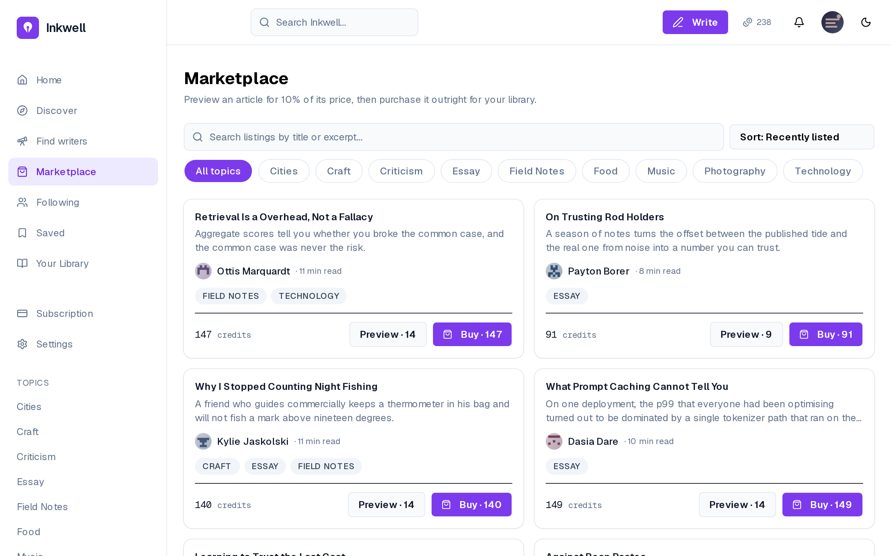{#fig:marketplace}

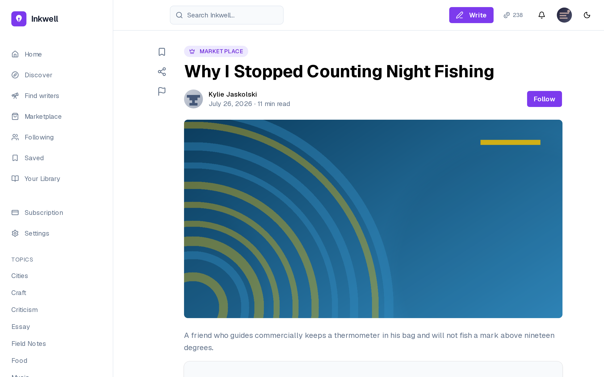{#fig:listing}

Each listing shows its writer, topics and price, and two buttons: *Preview* at 10% of
the price (14 credits for an article at 140) and *Buy* at the full price (FR-47). The
listing page shows the excerpt only; the body stays locked, as @fig:act-access
requires, until the magazine pays.

@fig:preview-confirm shows the confirmation of a preview unlock.

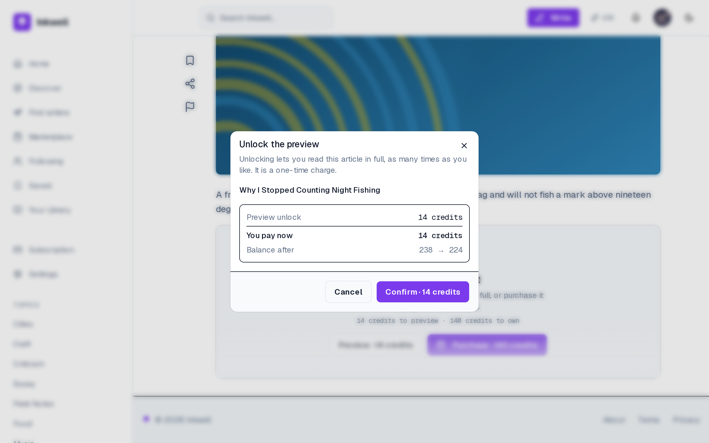{#fig:preview-confirm}

Before any credit moves, the dialog states what is bought, what is paid now and the
balance after (238 → 224), and requires an explicit *Confirm* (FR-48). It is the
screen of the first call of @fig:seq-purchase: the figures it shows are the ones the
transaction will write, so the magazine never discovers a charge after the fact.

After a full purchase the article lands in the magazine's library. @fig:library shows
it and @fig:publish-library the act of publishing from it.

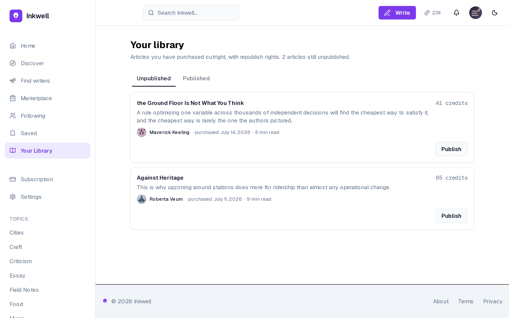{#fig:library}

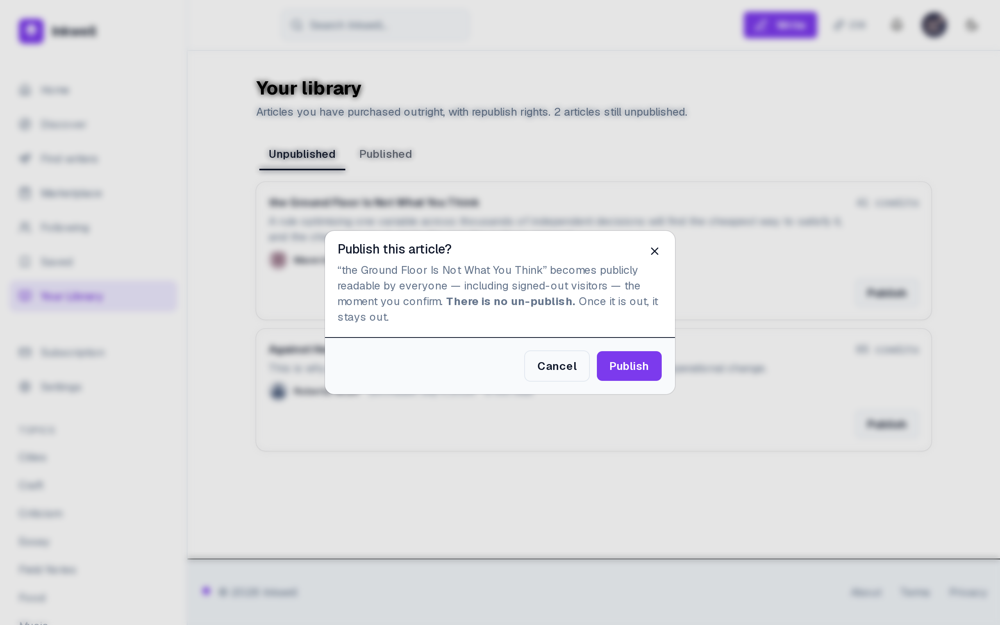{#fig:publish-library}

The library separates what is owned but unpublished from what has been published, with
the price paid and the purchase date of each article, and offers *Publish* only on the
first tab (FR-50, FR-74). Publishing is confirmed separately (FR-73): buying and
publishing are two decisions, as @tbl:rules requires.

Once published, the article becomes public. @fig:licensed shows it, and
@fig:magazine-profile the magazine's public profile.

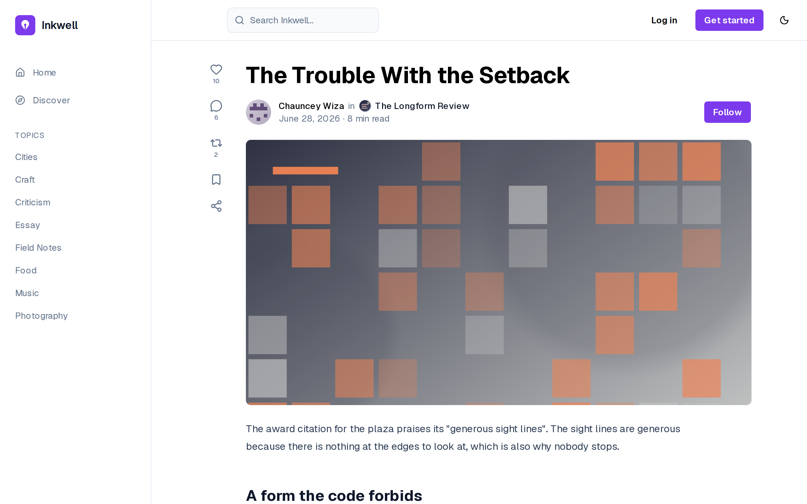{#fig:licensed}

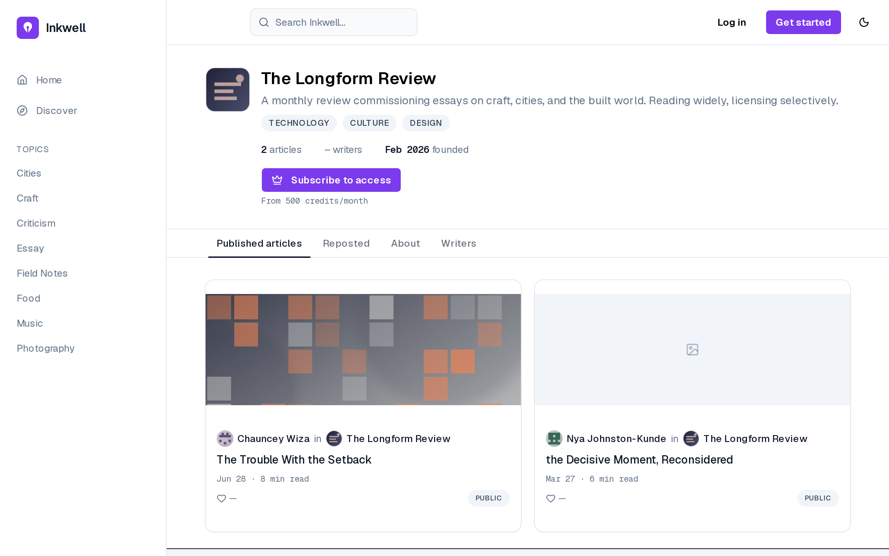{#fig:magazine-profile}

The licensed article names both the writer and the publishing magazine, each linking to
its profile (FR-76), and the magazine's profile lists the articles it has published
(FR-75). These two requirements are attributed to Sprint 5 because a licensed article
exists only from this sprint on: the licence buys the magazine a shelf, not just a file.

The writer sees the other side of the same transactions. @fig:earnings shows the
earnings and @fig:sold-article a sold article.

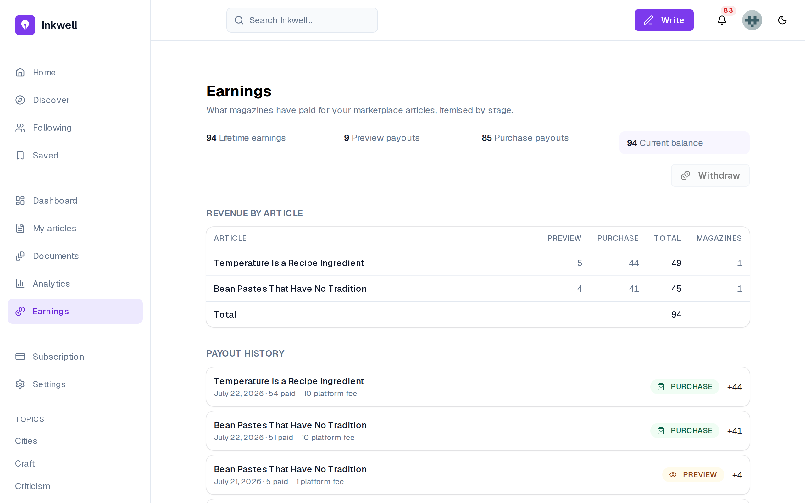{#fig:earnings}

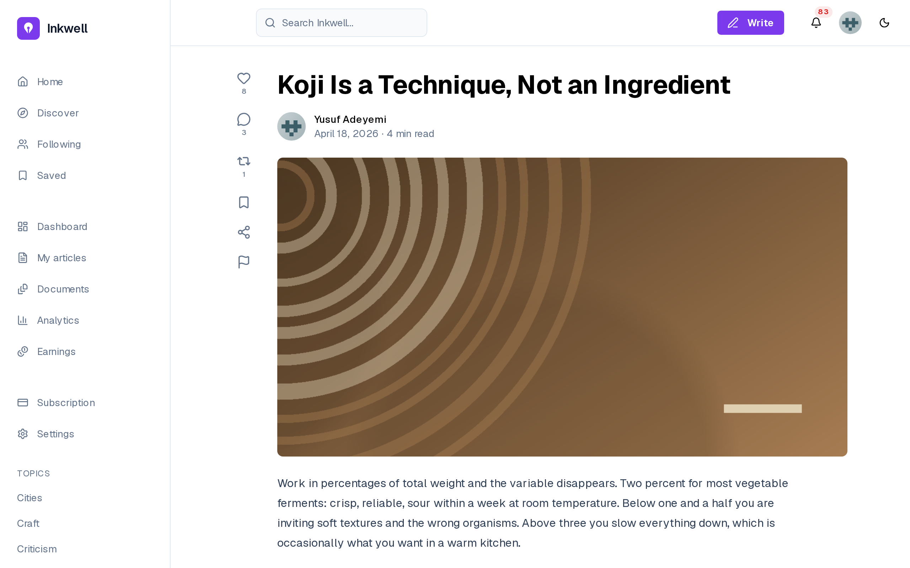{#fig:sold-article}

Earnings are itemised by article and stage: 54 credits paid, 10 of fee (20% rounded
down), 44 to the writer (FR-37). The arithmetic of @tbl:rules is visible line by line,
as US-42 asks. A sold article names its owner and can no longer be withdrawn or
deleted (FR-72).

The administrator closes the sprint. @fig:admin-grant shows a manual eligibility grant,
@fig:admin-users user management and @fig:admin-reports the report queue.

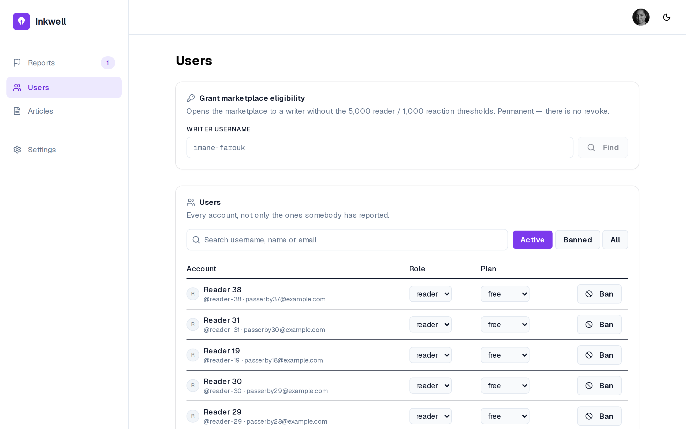{#fig:admin-grant}

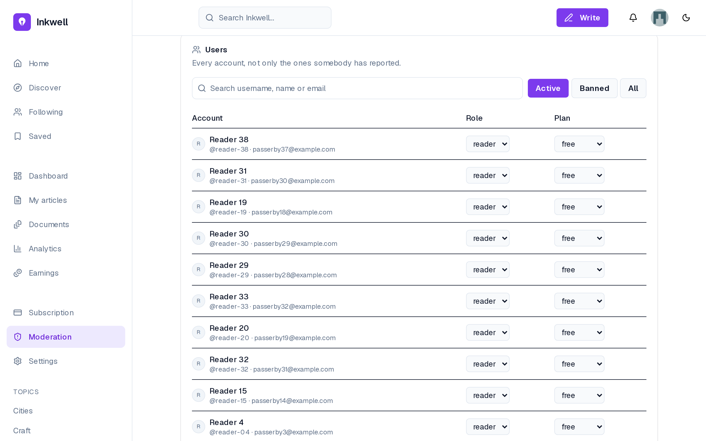{#fig:admin-users}

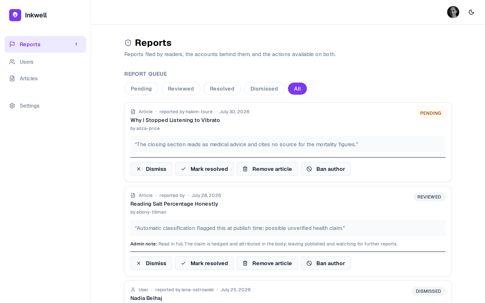{#fig:admin-reports}

The grant records who made a writer eligible (FR-55); the user table searches accounts
and edits a plan (FR-53, FR-54); the report queue offers the four actions of
@fig:seq-moderation (FR-51, FR-52). Its second report has no reporter: the classifier
filed it (FR-57), and the administrator's note explains why the article stayed: the
decision the design reserves for a person.

## Sprint 6: Tests, demonstration and deployment {#sec:sprint6}

### Sprint backlog

The goal of Sprint 6 is to prove the business rules with tests, to make the product
demonstrable on a realistic corpus, and to make it deployable with one command and an
automated pipeline. @tbl:sprint-6 lists the stories.

<!-- INCLUDE:sprint-6 -->

The sprint commits only {{S6PTS}} points because its main work is not expressed as user
stories: writing the tests that prove the rules of Sprint 5 adds no story, but it is
what the definition of done of the previous sprints relies on. The sprint is technical
on purpose. Placed after the marketplace and before the last release, it consolidates
the rules that move money before more features are built on top of them.

### Analysis

A technical sprint has no new actor-facing use case; its analysis states what must be
verified and what must be deployable. Three needs follow from the previous sprints.

- **Proof of the money rules.** The ledger, the prices and the exclusivity of Sprint 5
  must be shown correct by tests that fail when the code is wrong, not merely pass
  when it is right (NFR-06, NFR-19, NFR-20, NFR-31).
- **A demonstrable product.** A demonstration needs readers, writers above and below
  the eligibility thresholds, magazines with and without a subscription, purchases and
  history, none of which an empty database has (US-53, US-54).
- **A deployable stack.** The services must start in the right order, the schema must
  be migrated before the application, and the product must be reachable over TLS
  (NFR-21, US-52, US-55).

### Design

**Test strategy.** @fig:test-strategy shows the strategy.

{#fig:test-strategy}

**Unit and service tests** run against a real database, each in a rolled-back
transaction; **integration tests** go through the API; **end-to-end tests** drive a
browser. The **ledger harness** and a **price sweep** from 1 to 300 credits guard the
money. The database is never mocked: the guarantees under test live in it.

**Deployment.** The deployment follows the physical architecture of @fig:arch-physical
and the pipeline of @fig:arch-cicd: multi-stage images for the API and worker (one
image, two entry points) and for the Next.js server in standalone mode; a production
Compose file in which only nginx is published, with certificates from Let's Encrypt;
a one-shot migration service that must succeed before the API and worker start; and
health and readiness endpoints checked by Compose and by the deployment workflow.

### Realisation

**Test results.** @tbl:tests gives the state of the test suites at the end of the
project.

| Suite | Scope | Result |
|:----------------------|:----------------------------------------|:----------------------|
| Backend (Jest) | 52 suites: services, controllers, ledger, purchases, documents, voice, AI pipeline | **796 tests, all passing** |
| Ledger invariant harness | balance and ledger invariants, seed ledger | 34 tests, included above |
| Price sweep | prices 1–300, both stages, both splits | included above |
| Backend line coverage | statements executed by the suite | 48.5% of lines, 40.6% of branches |
| End-to-end (Playwright) | 25 spec files over the seeded corpus | 183 tests, outside the CI gate |
| Static gates | `tsc --noEmit` and `eslint --max-warnings=0`, both repositories | pass |

: Test results {#tbl:tests}

The 796 tests are not spread evenly, and the coverage per module shows where they
are. The moderation module is covered at 92% of its lines, the purchases at 77%, the
shared utilities at 73% and the data layer, where the ledger checks live, at 67%:
the code that moves money or removes content is the most tested, as the strategy
intended. The AI module (21%), authentication (28%) and the analytics aggregation (0%)
are the least covered: their logic is largely SQL and provider calls, verified by the
end-to-end suite and by the measurements of Chapter 7 rather than by unit tests. Line
coverage of 48.5% overall is therefore not a uniform level of confidence but a
concentrated one, and extending it to the aggregation queries is the first
improvement listed in the conclusion. The harness was itself validated by sabotage:
removing a filter from the earnings query or a stage from the debit list fails exactly
the tests that should fail, an exercise that found one coverage gap, which was then
closed.

**Demonstration corpus.** A seed command builds a believable dataset in seconds and can
rebuild it from scratch: its full preset creates **100 writers and 989 articles**,
**50 magazines** (30 with a live subscription), **150 readers**, 110 marketplace
listings with real purchases and ledger rows, and more than 15,000 likes, 2,700 reposts
and 8,000 comments, with generated cover art and avatars. A fixed cast of named
accounts makes every demonstration path reproducible, and a flag lowers the
eligibility thresholds so that the gate can be crossed live (US-54). Every seeded date
can be bounded below, so the corpus never predates the platform. The same corpus is
the one evaluated in Chapter 7.

**Deployment.** The production stack builds, migrates and starts with one command, and
its pipeline runs from a push to a running service (US-52). The domain `inkwell-ai.me`
is registered, but no server was provisioned during the project, so the product is not
yet reachable at a public address: **US-55 is only partly delivered**: its
configuration, TLS setup and pipeline are done, its hosting is not, and its 8 points
are not counted as delivered in the velocity of @sec:velocity.

## Conclusion {.unnumbered}

Release 3 delivered the marketplace end to end: subscriptions and credits, the
eligibility gate, the exclusive two-stage purchase, the magazine's own publication and
the writer's itemised earnings, all on a ledger whose invariants are tested after every
operation. It also delivered moderation, a test suite of 796 backend tests concentrated
on the rules that move money, a demonstration corpus and a production-ready stack whose
public hosting remains to be done. The last release deepens the social layer and
reworks the assistant.
