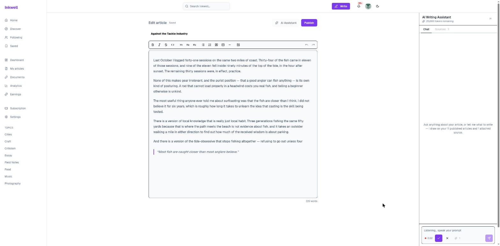

# Release 4: social depth, the reworked assistant and documents {#sec:ch6}

## Introduction {.unnumbered}

The last release deepens what the platform already did. Sprint 7 completes the social
layer with comment likes, follower lists, blocking, saving and sharing. Sprint 8
reworks the assistant: it now decides on each request whether to answer or to write
into the document, shows its real pipeline as it runs, and accepts and speaks voice;
the feed card becomes interactive. Sprint 9 gives the writer a private library of
reference documents that the assistant can draw on and cite by page.

## Sprint 7 — Comment likes, lists, block, save and share {#sec:sprint7}

### Sprint backlog

The goal of Sprint 7 is that readers like comments, browse and act on follower lists,
block accounts, keep articles for later and share them outside the platform.
@tbl:sprint-7 lists the stories.

<!-- INCLUDE:sprint-7 -->

The sprint commits {{S7PTS}} points, a light load: its five stories reuse the
interaction model of Sprint 3 — each is a new many-to-many association with a
notification — so they were small to estimate and to build. The sprint was kept light
deliberately, as the start of the release that runs alongside the writing of this
report.

### Analysis

@fig:uc-s7 gives the use cases of Sprint 7.

{#fig:uc-s7}

Sharing and the follower lists need no account; following from a list extends viewing
it. Liking a comment and saving an article include notifying the recipient. A block
hides the two accounts from each other — profiles, articles and comments — and the only
place to lift it is the blocker's settings. Saves are private: the author is notified,
but nobody else can see what a reader keeps. The diagram shows the difference between
the two new kinds of relationship: liking, following and sharing are public signals,
while saving and blocking are private choices that only their author can see.

### Design

@fig:classes-s7 shows the three new associations and the notification types they emit.

{#fig:classes-s7}

Comment likes, blocks and saves are many-to-many associations, each stored as a join
table with a unique constraint on its pair, so a repeated request is a no-op, and a
notification is emitted only when a row was actually inserted; a check constraint
forbids blocking oneself. A block row is directional, but every read treats it both
ways. Comment likes are kept apart from article likes, so that by construction they can
never count towards a writer's eligibility. The diagram shows that the sprint changed no
existing class: the social layer grew by association only, which is why it could be
added at the end without reopening the marketplace rules.

### Realisation

@fig:saved shows the Saved shelf of a reader.

{#fig:saved}

The page states that only the reader can see the list, and every card keeps its
controls, with the save marker filled (FR-63, FR-64). A saved article stays one click
away from the sidebar, which is what US-57 asks.

@fig:blocked shows the blocked accounts in settings.

{#fig:blocked}

Blocks are listed in one place, each with *Unblock* (FR-62), under a sentence that
states the rule: neither account sees the other's profile, articles or comments, and
unblocking does not restore a previous follow. Putting the list in settings rather
than on profiles follows from the analysis: a block is a private decision, so it is
reviewed privately.

@fig:following-feed shows the feed restricted to followed accounts, and
@fig:followers-search a follower list being searched.

{#fig:following-feed}

{#fig:followers-search}

The following feed shows only the writers a reader follows, and the follower lists can
be browsed, searched and acted on — following back from the list itself (FR-61). Both
turn the follow relationship of Sprint 3 into a way to discover people through people.

## Sprint 8 — Live cards, the assistant that writes, and voice {#sec:sprint8}

### Sprint backlog

The goal of Sprint 8 is that readers react, repost and comment from the feed card, see
recent comments and preview any byline; and that the assistant decides whether to
answer or to write into the document, writes into a protected range the writer keeps or
discards, shows its steps as they run, sits in a panel docked beside the editor,
accepts dictated prompts and reads its replies aloud. @tbl:sprint-8 lists the stories.

<!-- INCLUDE:sprint-8 -->

The sprint commits {{S8PTS}} points in two halves of similar size: the live feed card
and its neighbours on one side, the reworked assistant and voice on the other. The
largest story, US-66 (8 points), is the write into the document, which needed a new
editor extension as well as a new kind of model call.

### Analysis

@fig:uc-s8 gives the use cases of Sprint 8.

{#fig:uc-s8}

Briefing the assistant specialises into receiving an answer in the panel and having
text written into the document, and includes following the live pipeline steps and
consuming the allowance; keeping or discarding the written text includes the write.
Dictating extends the brief and is billed; hearing the reply extends the answer. The
choice between answering and writing is the assistant's, made per message; it
supersedes the manual "insert the answer into the document" of Sprint 2 (FR-30,
superseded by FR-78). The diagram shows the change of role: in Sprint 2 the writer
copied text from a chat, in Sprint 8 the assistant writes where the writer works and
the writer keeps or discards it.

### Design

**Sequence diagram — one assistant turn.** @fig:seq-turn shows a turn.

{#fig:seq-turn}

The request carries the conversation, the article and any selection. The system reads
the draft, the writer's voice profile and — when documents are attached — passages from
them, reporting each stage to the panel as it completes. A single routing call to the
model then either answers in the panel, streamed as Markdown, or calls the
`write_to_article` tool with a placement (at the cursor or over the selection) and a
one-line brief; the model then adds a one-line recap. The tokens of both calls are
settled once, at the end; a stopped turn still bills an estimate of what was produced.
The diagram shows why the panel can show real steps rather than a spinner: each stage
is a part of the response stream, sent as soon as it is done (FR-80).

**Sequence diagram — writing into the document.** @fig:seq-write shows the write.

{#fig:seq-write}

The system retrieves passages from the writer's other published articles and streams
the article text from a second model call. The panel opens a range in the editor at a
block boundary — after the block holding the cursor, or over the selected blocks — tints
it and refuses the writer's own edits inside it; each Markdown block is inserted as
soon as it is complete, outside the undo history. When the stream ends, the writer
keeps the text, which becomes one undo step, or discards it, which restores exactly
what was there. The diagram shows the guarantee behind the design: opening the range at
a block boundary is what makes the restoration exact, because every node the writer
owns stays untouched.

**Sequence diagram — voice.** @fig:seq-voice shows the voice round trip.

{#fig:seq-voice}

A recording of at most five minutes is sent with its length; the system checks the
allowance, the format and the size, transcribes it with Whisper, settles the
duration — the provider's when it reports one, otherwise the larger of the client's
figure and a floor derived from the file size — and bills 200 tokens per started
minute. The transcript lands in the composer, editable. Reading a reply aloud is free
to the writer and limited per account instead, to 20 replies a minute and 300 a day.
The diagram shows that the client's claim about duration is never trusted alone: the
billing uses the larger of what the client says and what the file size proves.

### Realisation

@fig:reposted shows the Reposted tab of a profile.

{#fig:reposted}

Any account's reposts can be read from its profile, without an account (FR-67): what a
person passes on is part of how others judge their taste.

@fig:keep-discard shows a write awaiting the writer's decision.

{#fig:keep-discard}

Asked for a closing paragraph "in my voice", the assistant chose to write rather than
answer (FR-78). The panel lists the real steps — words read, profile, thinking, five
passages from four articles, the size of the write — and a one-line recap; in the
editor, the new paragraph is tinted at the end of the draft with *Keep*, *Discard* and
the reminder that Ctrl+Z undoes after keeping (FR-79, FR-80). While the decision is
pending, the composer is disabled: the writer cannot start a second write over an
undecided one.

@fig:rail shows the live step on the collapsed panel.

{#fig:rail}

With the panel collapsed to a rail, the editor takes the full width and a write still
streams into the document; the rail keeps the chat, the sources and the voice controls
one click away, and its marker signals activity (FR-81). A slow step is therefore never
mistaken for a frozen screen, as US-67 requires.

@fig:voice shows a prompt being recorded.

{#fig:voice}

While recording, the composer says *Listening… speak your prompt* and shows the
elapsed time with a control to confirm and one to cancel; on confirmation the
transcript fills the composer, where it can be edited before sending (FR-82).
Dictation is billed against the same daily allowance as typed prompts, so voice is a
way of writing a prompt, not a separate service.

## Sprint 9 — Document library and citations {#sec:sprint9}

### Sprint backlog

The goal of Sprint 9 is that a writer uploads reference documents into a private
library, attaches them to an article, and that the assistant draws on them for answers
and writes, citing each passage by document and page. @tbl:sprint-9 lists the stories.

<!-- INCLUDE:sprint-9 -->

The sprint commits {{S9PTS}} points, the lightest load of the project after Sprint 7:
the ingestion reuses the chunking and embedding pipeline of Sprint 4, so most of the
work is the extraction of text page by page and the citation format. It ran alongside
the end of the writing of this report.

### Analysis

@fig:uc-s9 gives the use cases of Sprint 9.

{#fig:uc-s9}

Managing the library specialises into uploading, retrying a failed document and
deleting; uploading and retrying include extracting, chunking and embedding the text.
Attaching documents to an article is extended by detaching one. Asking the assistant
is extended by citing passages as *[Title, p. N]*, itself extended by opening a cited
passage at its page. Documents are PDF, DOCX, TXT or Markdown files under 10 MB and 200
pages, at most 20 per writer. The diagram shows the privacy boundary of the feature: a
document is the writer's alone, and it never feeds the voice profile, portfolio
insights or search (FR-87).

### Design

**Class diagram.** @fig:classes-s9 shows the library.

{#fig:classes-s9}

A `Document` carries its status, page and chunk counts and a readable error; its
`DocumentChunk`s each keep the page they came from, which is what a citation points to;
and documents are attached to articles by a many-to-many association. The status moves
from pending to extracting to ready, or to failed with a reason the writer can act on;
the only backward move is a retry. The diagram shows that a citation is a property of
the data, not of the model's output: the page number travels with the chunk from
extraction to the prompt.

**Sequence diagram — ingestion.** @fig:seq-ingest shows a document's path, the
companion of the publishing pipeline of @fig:seq-publish.

{#fig:seq-ingest}

The browser asks for a presigned URL and uploads the file straight to a private
bucket — the file never passes through the API. The registration checks that the object
exists and is under 10 MB, counts the writer's documents under a per-writer lock and
queues ingestion. The worker extracts the text page by page, refuses a document over
200 pages or without a text layer with a readable reason, then chunks it, embeds the
chunks and marks it ready in one transaction. The diagram shows that a document is
either fully usable or clearly refused: there is no state in which the assistant can
retrieve half a document.

### Realisation

@fig:documents shows the document library.

{#fig:documents}

The library lists each document with its type, pages, status, size and upload time,
and counts the documents against the limit — 2 of 20 (FR-84). One document is being
extracted; the other is refused with the reason "This document has no text to read"
and offers a retry: a failure is stated in words the writer can act on, not as an error
code.

@fig:sources shows the attachment of a document from the Sources tab of the assistant.

{#fig:sources}

The tab separates the documents attached to this article from the writer's whole
library, where a checkbox attaches or detaches each ready document and a failed one is
shown with its reason; the attachment is saved immediately (FR-85). Attaching per article is what keeps the assistant's material
relevant: notes for one piece are not fed into another.

@fig:cited shows a reply citing its source.

![A reply citing its source as [Title, p. N]](../figures/screens/writer-18-ai-cited-reply.png){#fig:cited}

Asked a factual question about the writer's field notes, the assistant retrieved three
passages from one document and answered with the figure and its source,
*[Tackle Market Field Notes, p. 2]* (FR-86). The steps above the answer show where the
facts came from before the answer is read. The writer can therefore check a claim
before it goes out under their name, which is the purpose of US-72.

## Conclusion {.unnumbered}

Release 4 completed the social layer, turned the assistant from a chat beside the
editor into a collaborator that writes into the document under the writer's control,
added voice in both directions, and gave the writer a private library of sources the
assistant can cite to the page. The next chapter evaluates the result.
