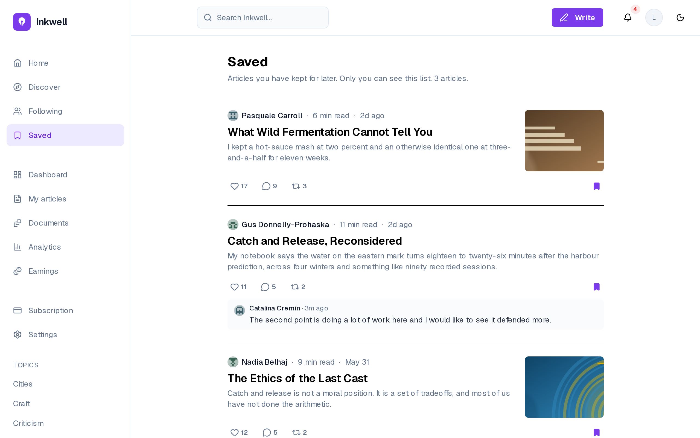
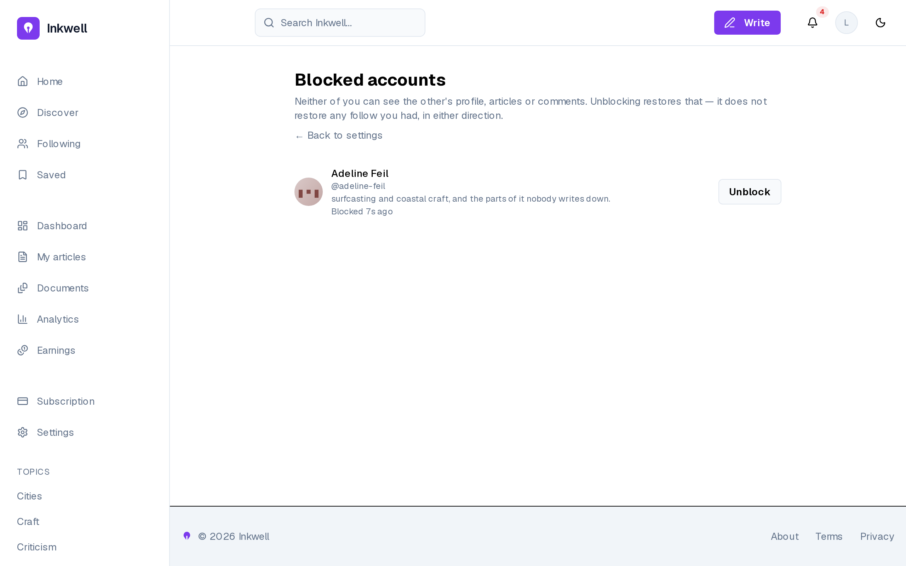
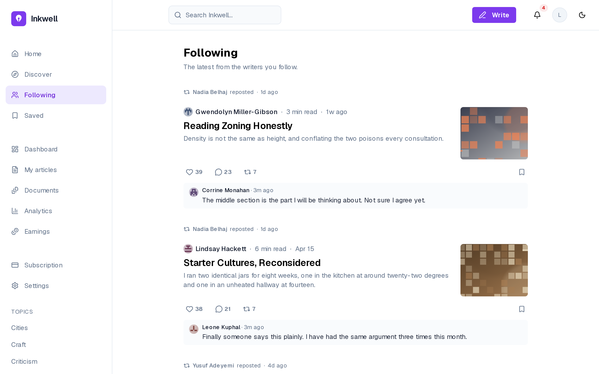
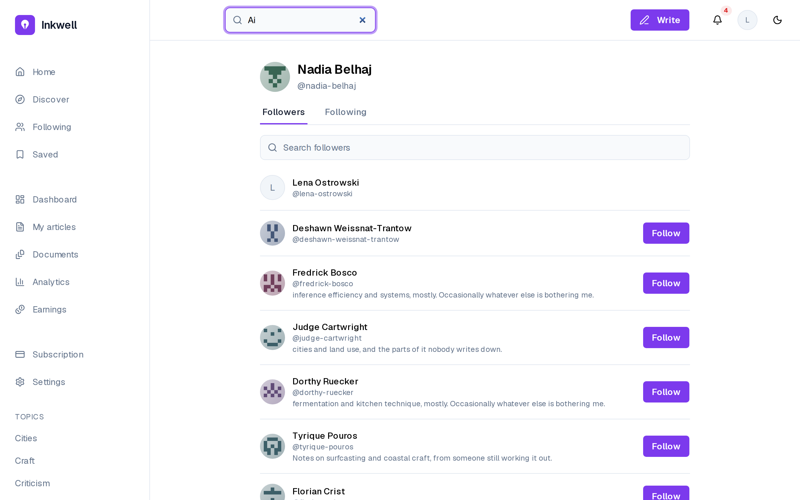
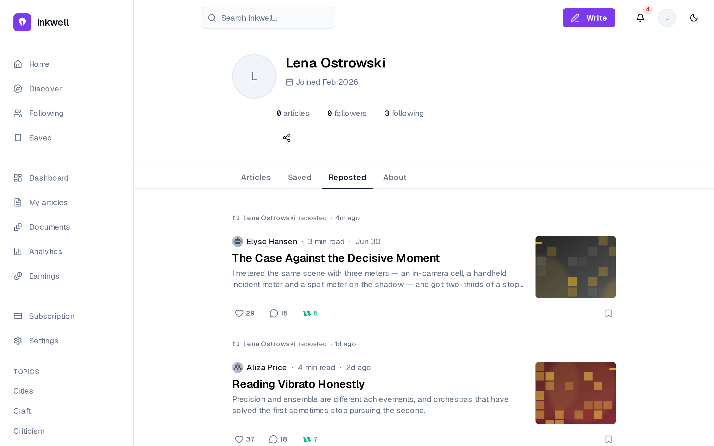
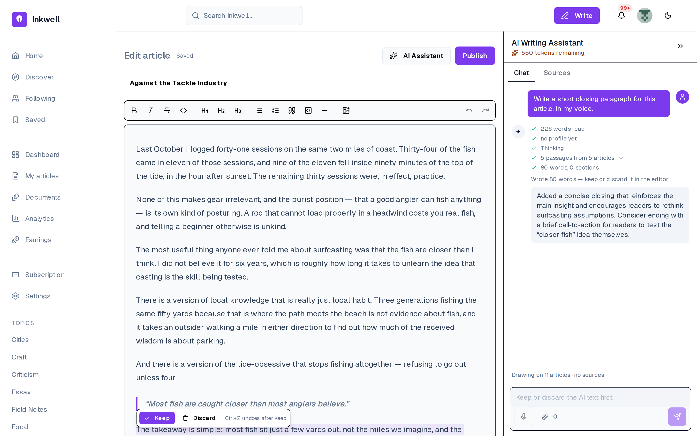
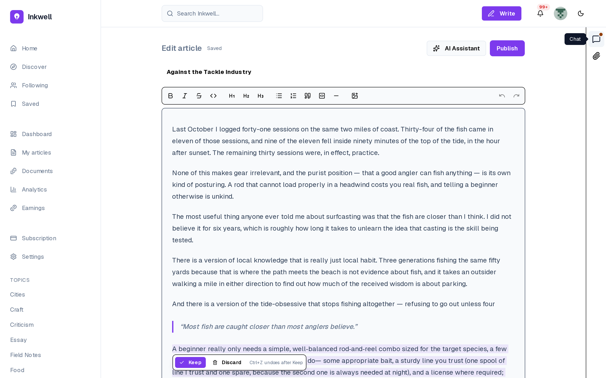
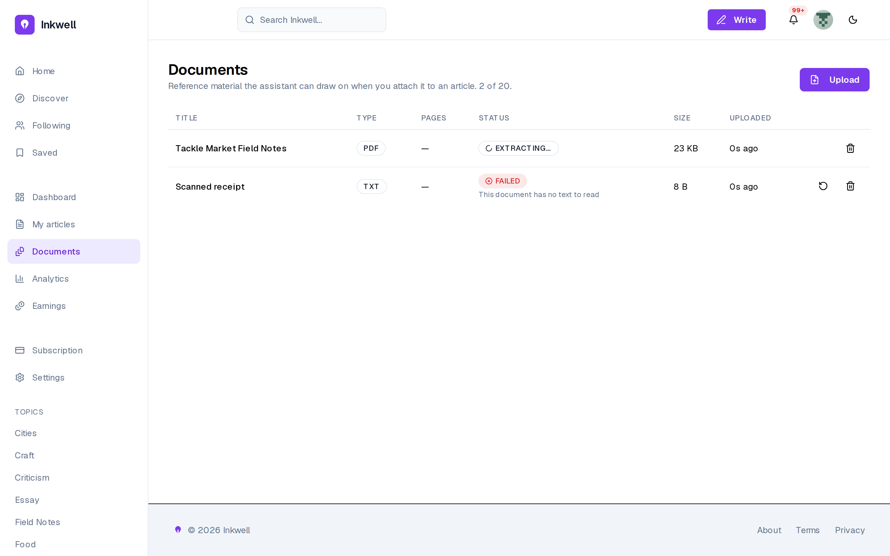
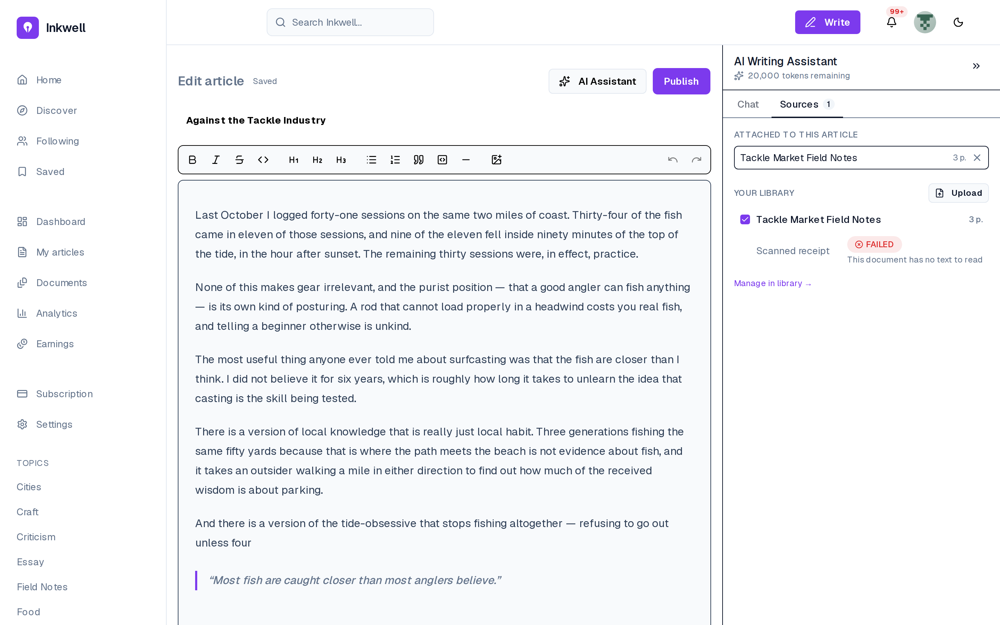

# Release 4: social depth, the reworked assistant and documents {#sec:ch6}

## Introduction {.unnumbered}

The last release deepens what the platform already did. Sprint 7 completes the social
layer with comment likes, follower lists, blocking, saving and sharing. Sprint 8
reworks the assistant: it now decides on each request whether to answer or to write
into the document, shows its real pipeline as it runs, and accepts and speaks voice.
The feed card becomes interactive. Sprint 9 gives the writer a private library of
reference documents that the assistant can draw on and cite by page.

## Sprint 7: Comment likes, lists, block, save and share {#sec:sprint7}

### Sprint backlog

The goal of Sprint 7 is that readers like comments, browse and act on follower lists,
block accounts, keep articles for later and share them outside the platform.
@tbl:sprint-7 lists the stories.

<!-- INCLUDE:sprint-7 -->

The sprint commits {{S7PTS}} points, a light load: its 5 stories reuse the
interaction model of Sprint 3 (each is a new many-to-many association with a
notification), so they were small to estimate and to build. The sprint was kept light
deliberately, as the start of the release that runs alongside the writing of this
report.

### Analysis

@fig:uc-s7 gives the use cases of Sprint 7.

{#fig:uc-s7}

Sharing and the follower lists need no account. Following from a list extends
viewing it. Liking a comment and saving include a notification. A block hides 2
accounts from each other and is lifted only in the blocker's settings, and saves are
private. Liking, following and sharing are public signals. Saving and blocking are
private choices only their author sees.

### Design

@fig:classes-s7 shows the 3 new associations and the notification types they emit.

{#fig:classes-s7}

Comment likes, blocks and saves are many-to-many associations, each with an
association class (`CommentLike`, `Block`, `Save`), created by the operations this
sprint adds to `User`. Each is a join table with a unique pair, so a
repeated request is a no-op. A block works both ways, and comment likes never count
towards eligibility. No existing class changed: the social layer grew by association
only, without reopening the marketplace rules.

### Realisation

@fig:saved shows the Saved shelf of a reader.

{#fig:saved}

The page states that only the reader can see the list, and every card keeps its
controls, with the save marker filled (FR-63, FR-64). A saved article stays one click
away from the sidebar, which is what US-57 asks.

@fig:blocked shows the blocked accounts in settings.

{#fig:blocked}

Blocks are listed in one place, each with *Unblock* (FR-62), under a sentence that
states the rule: neither account sees the other's profile, articles or comments, and
unblocking does not restore a previous follow. Putting the list in settings rather
than on profiles follows from the analysis: a block is a private decision, so it is
reviewed privately.

@fig:following-feed shows the feed restricted to followed accounts, and
@fig:followers-search a follower list being searched.

{#fig:following-feed}

{#fig:followers-search}

The following feed shows only the writers a reader follows, and the follower lists can
be browsed, searched and acted on, including following back from the list itself (FR-61). Both
turn the follow relationship of Sprint 3 into a way to discover people through people.

## Sprint 8: Live cards, the assistant that writes, and voice {#sec:sprint8}

### Sprint backlog

The goal of Sprint 8 is that readers react, repost and comment from the feed card, see
recent comments and preview any byline, and that the assistant decides whether to
answer or to write into the document, writes into a protected range the writer keeps or
discards, shows its steps as they run, sits in a panel docked beside the editor,
accepts dictated prompts and reads its replies aloud. @tbl:sprint-8 lists the stories.

<!-- INCLUDE:sprint-8 -->

The sprint commits {{S8PTS}} points in 2 halves of similar size: the live feed card
and its neighbours on one side, the reworked assistant and voice on the other. The
largest story, US-66 (8 points), is the write into the document, which needed a new
editor extension as well as a new kind of model call.

### Analysis

@fig:uc-s8 gives the use cases of Sprint 8.

{#fig:uc-s8}

Briefing the assistant specialises into an answer or a write into the document, and
includes the live steps and the allowance. Dictation and replies read aloud extend
it. The assistant chooses per message, replacing the manual insert of Sprint 2
(FR-78 supersedes FR-30).

### Design

**Sequence diagram: one assistant turn.** @fig:seq-turn shows a turn.

{#fig:seq-turn}

The system reads the draft, the voice profile and any documents, reporting each
stage. One routing call answers in the panel or calls `write_to_article`, then adds a
recap. Tokens are settled at the end. The panel shows real steps because each stage
is part of the response stream (FR-80).

**Sequence diagram: writing into the document.** @fig:seq-write shows the write.

{#fig:seq-write .foldout height=88%}

The text streams into a protected range opened at a block boundary, block by block.
The writer then keeps it, as one undo step, or discards it, restoring exactly what
was there. It is exact because the range starts at a block boundary and touches no node
the writer owns.

**Sequence diagram: voice.** @fig:seq-voice shows the voice round trip.

{#fig:seq-voice .foldout .here height=88%}

A recording of up to 5 minutes is transcribed with Whisper and billed 200 tokens
per started minute, the transcript landing in the composer. The duration billed is
the provider's, or the larger of the client's figure and a floor from the file size:
the client's claim is never trusted alone.

### Realisation

@fig:reposted shows the Reposted tab of a profile.

{#fig:reposted}

Any account's reposts can be read from its profile, without an account (FR-67): what a
person passes on is part of how others judge their taste.

@fig:keep-discard shows a write awaiting the writer's decision.

{#fig:keep-discard}

Asked for a closing paragraph "in my voice", the assistant chose to write (FR-78):
the panel lists its steps and a recap, and the tinted paragraph offers *Keep* and
*Discard* (FR-79, FR-80). The composer stays disabled until the writer decides.

@fig:rail shows the live step on the collapsed panel.

{#fig:rail}

With the panel collapsed to a rail, the editor takes the full width and a write still
streams into the document. The rail keeps the chat, the sources and the voice controls
one click away, and its marker signals activity (FR-81). A slow step is therefore never
mistaken for a frozen screen, as US-67 requires.

Voice input is not a separate screen: it lives in the same composer, behind the
microphone at its bottom left (visible in @fig:keep-discard). While recording, the
composer shows *Listening… speak your prompt*, the elapsed time and controls to confirm
or cancel. The transcript then fills the composer, editable, before anything is sent
(FR-82). The round trip behind it is the one in @fig:seq-voice. Dictation uses the same
allowance as typing: voice is a way to write a prompt, not a separate conversation.

## Sprint 9: Document library and citations {#sec:sprint9}

### Sprint backlog

The goal of Sprint 9 is that a writer uploads reference documents into a private
library, attaches them to an article, and that the assistant draws on them for answers
and writes, citing each passage by document and page. @tbl:sprint-9 lists the stories.

<!-- INCLUDE:sprint-9 -->

The sprint commits {{S9PTS}} points, the lightest load of the project:
the ingestion reuses the chunking and embedding pipeline of Sprint 4, so most of the
work is the extraction of text page by page and the citation format. It ran alongside
the end of the writing of this report.

### Analysis

@fig:uc-s9 gives the use cases of Sprint 9.

{#fig:uc-s9}

Managing the library specialises into uploading, retrying and deleting. Uploading
includes extracting, chunking and embedding. Attaching is extended by detaching, and
asking the assistant by citing *[Title, p. N]*. Documents are PDF, DOCX, TXT or
Markdown, under 10 MB and 200 pages, 20 per writer. A document is private: it never
feeds the voice profile, insights or search (FR-87).

### Design

**Class diagram.** @fig:classes-s9 shows the library.

{#fig:classes-s9}

A `Document` carries its status, counts and a readable error. Each `DocumentChunk`
keeps its page, and documents attach to articles many-to-many. The status only moves
forward, except a retry. A citation is a property of the data: the page travels with
the chunk to the prompt.

**Sequence diagram: ingestion.** @fig:seq-ingest shows a document's path, the
companion of the publishing pipeline of @fig:seq-publish.

{#fig:seq-ingest .foldout .sideways .here height=88%}

The file goes straight to a private bucket through a presigned URL, never through the
API. Registration checks it and the 20-document limit. The worker extracts the text
page by page and chunks, embeds and marks it ready in one transaction, or refuses it
with a reason. No document is half usable.

### Realisation

@fig:documents shows the document library.

{#fig:documents}

The library lists each document's type, pages, status, size and upload time against
the limit of 20 (FR-84). One document is extracting. The other is refused ("This
document has no text to read") with a retry: failures are stated in words the writer
can act on.

@fig:sources shows the attachment of a document from the Sources tab of the assistant.

{#fig:sources}

The tab separates the documents attached to this article from the writer's whole
library, where a checkbox attaches or detaches each ready document and a failed one is
shown with its reason. The attachment is saved immediately (FR-85). Attaching per article is what keeps the assistant's material
relevant: notes for one piece are not fed into another.

@fig:cited shows a reply citing its source.

![A reply citing its source as [Title, p. N]](../figures/screens/writer-18-ai-cited-reply.png){#fig:cited}

Asked a factual question, the assistant retrieved 3 passages from one document
and answered with the figure and its source, *[Tackle Market Field Notes, p. 2]*
(FR-86). The writer can check a claim before it goes out under their name, the
purpose of US-72.

## Conclusion {.unnumbered}

Release 4 completed the social layer, turned the assistant from a chat beside the
editor into a collaborator that writes into the document under the writer's control,
added voice in both directions, and gave the writer a private library of sources the
assistant can cite to the page. The next chapter evaluates the result.
